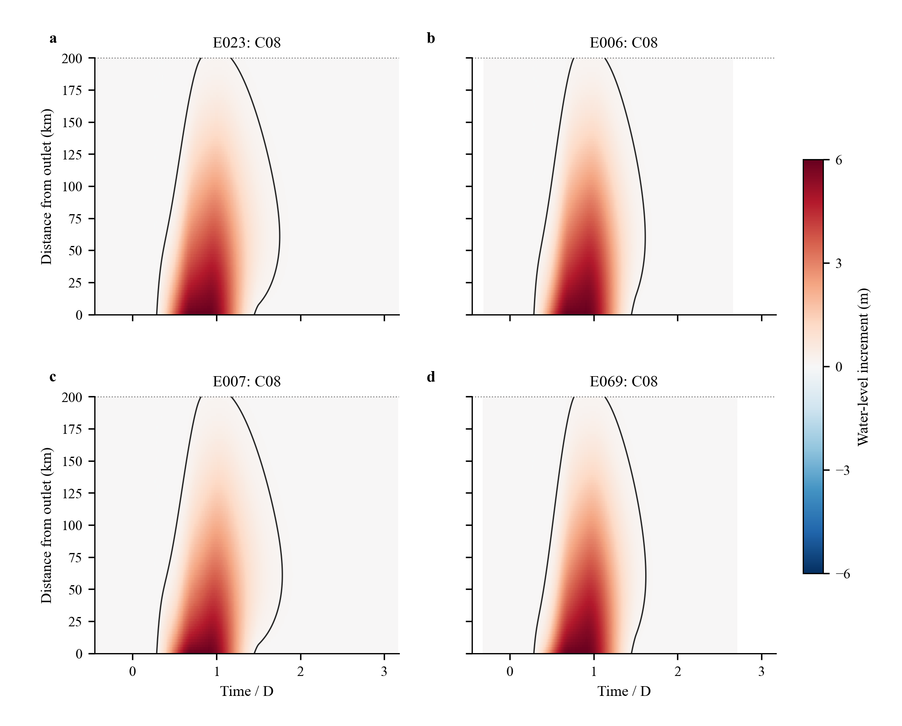
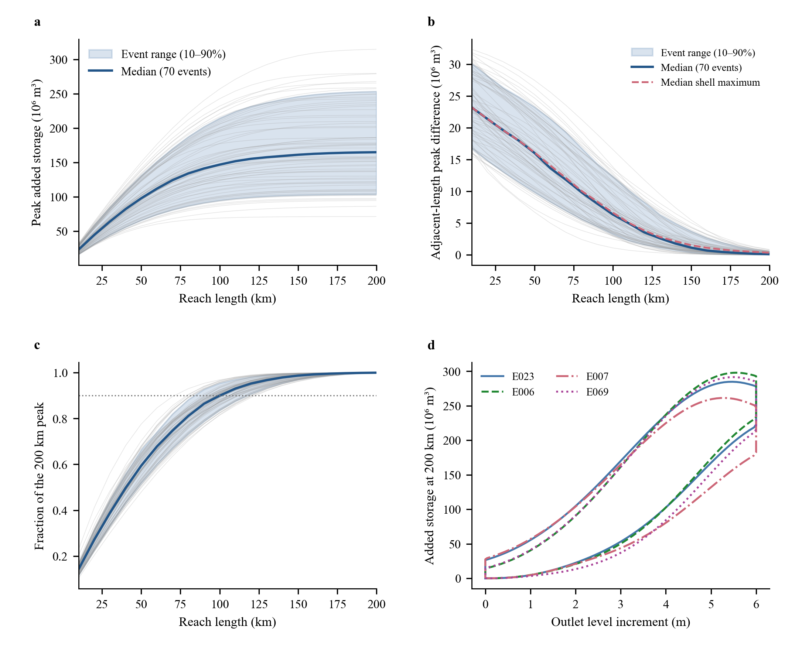
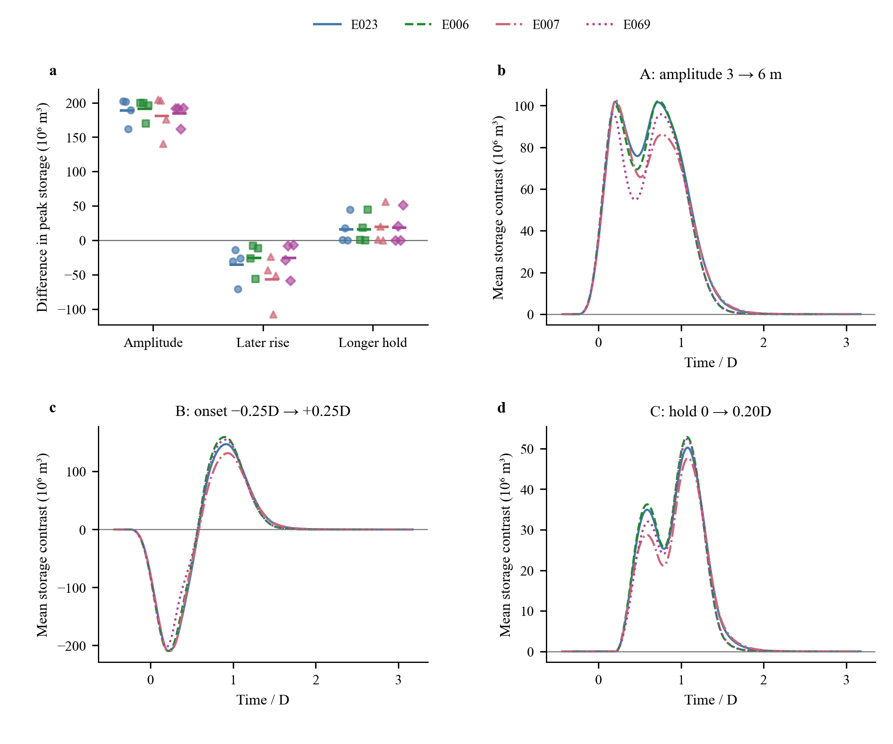

# 河长与动态下游水位对附加滞蓄的影响

现有计算支持一个清楚的认识：相对于固定下游水位，水位抬升使附加蓄量主要集中在靠近出口的河段，并向上游逐渐减弱；河道继续加长时，新增蓄量的边际贡献随之下降。边界水位的上涨时机和维持时间还会改变蓄量的形成与释放过程，因而相同的当前下游水位可以对应不同的附加蓄量。这些认识来自已冻结的 70 场率定洪水及其中 4 个洪水背景的 32 次控制实验。其余 30 场洪水仅核对了计算完整性和质量记录，没有参与本阶段的图表、规律提取与模型选择。

所有增量均以同一洪水、下游固定 5 m 的计算为参照。这里的“回水影响”指相对于该参照新增的水位响应，固定 5 m 本身不代表没有回水。以内部断面水位增量超过 0.10 m 为工作标准，70 场率定洪水的最远影响断面为 144—200 km，中位数为 180 km。其中 15 场触及 200 km 上游边界，它们的影响终点在现有计算域内没有被识别出来；记录中的 200 km 是观测下界。阈值改为 0.05 m 后，有 41 场触及边界；改为 0.20 m 后，没有事件触及边界。这说明影响范围具有明确的阈值依赖，不能将某一条阈值曲线当作唯一的物理分界。本批率定事件在这些阈值下未出现分离的正增量区段，完整有符号响应及分段检查仍然保留。

200 km 河段的峰值附加蓄量为 0.714—3.147 亿 m³，中位数为 1.650 亿 m³。各事件的峰值随河长均单调增加，但不是等比例增加：达到各自 200 km 峰值的 90% 需要 80—130 km，达到 95% 需要 90—150 km。100 km 河段所占峰值比例的中位数为 89.99%，150 km 为 98.73%。这些比例以 200 km 结果为分母，只说明本计算域内的集中与饱和趋势，不能解释为无限长河道的容量已经完全饱和。

“每增加 10 km”必须区分峰值曲线的相邻差和某一空间段本身的最大附加蓄量。前者允许两个河长在不同时间取峰值；后者先在同一时刻作空间差，再沿时间取最大值。以最上游的 190—200 km 段为例，70 场事件的相邻河长峰值差中位数为 12.19 万 m³，该空间段自身最大附加蓄量的中位数则为 34.56 万 m³。二者不同并非守恒矛盾，而是取最大值与作空间差的顺序不同。因此，空间增量过程及两种峰值指标均已分别导出。

控制实验将三个因素分开改变，并在每个洪水背景内保持其余条件不变。下表只概括 200 km 河段的峰值响应；每个因素的 16 个条件对比来自 4 个洪水背景，每个背景下有 4 个不同条件，不能把它们视为 16 场独立洪水。数值均为高水平减低水平，单位为百万 m³。

| 因素改变 | 峰值差范围 | 峰值差中位数 | 方向 |
|---|---:|---:|---|
| 水位幅度 3→6 m | 140.29—204.30 | 191.98 | 16 个条件均增加 |
| 上涨起点 −0.25D→+0.25D | −107.43—−6.99 | −27.45 | 16 个条件均减少 |
| 高位维持 0→0.20D | 0—56.05 | 9.40 | 15 个增加，1 个不变 |

水位幅度是这些有限水平对比中影响峰值最强的因素。上涨时机的结果则需要保留其具体背景：在本次规定的起点、上涨历时、洪水形状和几何条件下，推迟上涨都降低了峰值附加蓄量；这不意味着任意河道、任意时序下推迟上涨都会有相同方向的作用。16 个时机对比中有 4 个反而增加了附加蓄量对时间的积分，说明“峰值降低”和“滞蓄过程总体减弱”不能直接互换。

增加高位维持时间对蓄量过程的影响比单一峰值更稳定：16 个条件均增加了附加蓄量的时间积分。表中 15 个正峰值差只是当前数值输出的符号，其中有 3 个正差小于 5 万 m³，另有 1 个为零；这 4 个对比应按峰值接近不变理解，不把微小正差强调为已经解析的物理增强。该时间积分的单位为 m³·h，用于描述附加蓄量在时间上的累积暴露，不是水量，也不能解释为多拦蓄了一份等值洪水体积。E069 的 C05 与 C06 是一个具体例子：两者的 200 km 峰值同为 2.9857 亿 m³，均出现在洪水起点后约 28 h；两种水位过程在约 30.11 h 才开始分离，因此已发生的共同峰值不受维持阶段影响。然而，在后续同一时刻，两者附加蓄量差的最大值达到约 9799.5 万 m³。高位维持在这个例子中主要改变了后续释放过程。由于维持时间的增加也同步延后退水起点，现有控制设计识别的是两者共同产生的有限水平效应。

水位恢复后仍有附加蓄量，是进一步约束修正形式的重要证据。70 场率定洪水在下游水位恢复至 5 m 时，仍保留各自 200 km 峰值附加蓄量的 2.39%—18.89%，中位数为 5.91%；恢复后最后一次观测到附加蓄量高于其峰值 1% 的时刻，中位数约为 28.8 h，范围约为 12.5—55.1 h。恢复时刻的蓄量由相邻小时结果线性插值，持续时间指标受 1 h 输出分辨率限制。水位—蓄量曲线的涨落支也不重合。不过，涨落支的入口流量并不相同，这些结果说明仅用河长与当前下游水位不能唯一重建实际附加蓄量，不能进一步将差异全部归因于一个独立的记忆参数。

这些诊断尚不决定 RWEC 修正项的具体形式。HEC 的几何附加蓄量是待解释的响应量，不应直接等同于 RWEC 的标准蓄量修正；RWEC 自身递推也已包含状态记忆。因此，可以据此要求候选结构接受河长饱和、边界恢复及涨落支差异的检验，但是否需要在修正项中另设动态状态，仍须在原有递推结构中比较。第二阶段应先核实原式与变量定义，再固定一个可审查的 RWEC-1 假设，与 RWEC-0 按相同率定规则比较。HEC 的真实蓄量和阈值影响范围可以作为开发阶段诊断目标，不能作为验证事件的预测输入。

附加蓄量的几何积分已用原生断面水位独立重建，并与现有配对文件核对；同时利用原生累计通量，计入每个短河段入口与出口的流量差，核对配对水量平衡。70 场率定事件中，配对原生守恒残差相对于各自 200 km 峰值附加蓄量的最大比例约为 0.00321%。这支持当前数据提取和守恒口径的一致性，不代表真实河道预测误差达到这一水平。所有原始模型、边界、计算结果和既有失败记录均保持原状。

完整方法见 [METHODS.md](METHODS.md)，图注与条件编码见 [FIGURE_LEGENDS.md](FIGURE_LEGENDS.md)。各河长指标、全部时间序列的影响范围、同水位对比和控制因素效应均保存在 [tables](tables) 中。四组控制实验的完整诊断图为 [E023](figures/control_E023.pdf)、[E006](figures/control_E006.pdf)、[E007](figures/control_E007.pdf) 和 [E069](figures/control_E069.pdf)。
