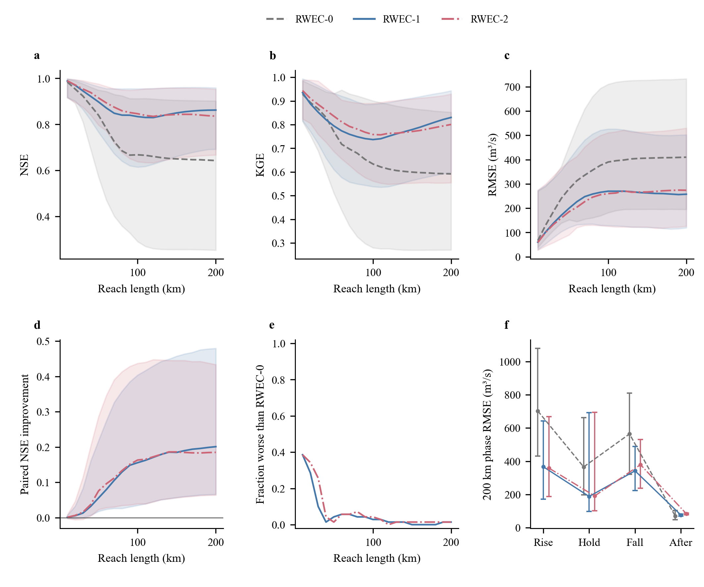
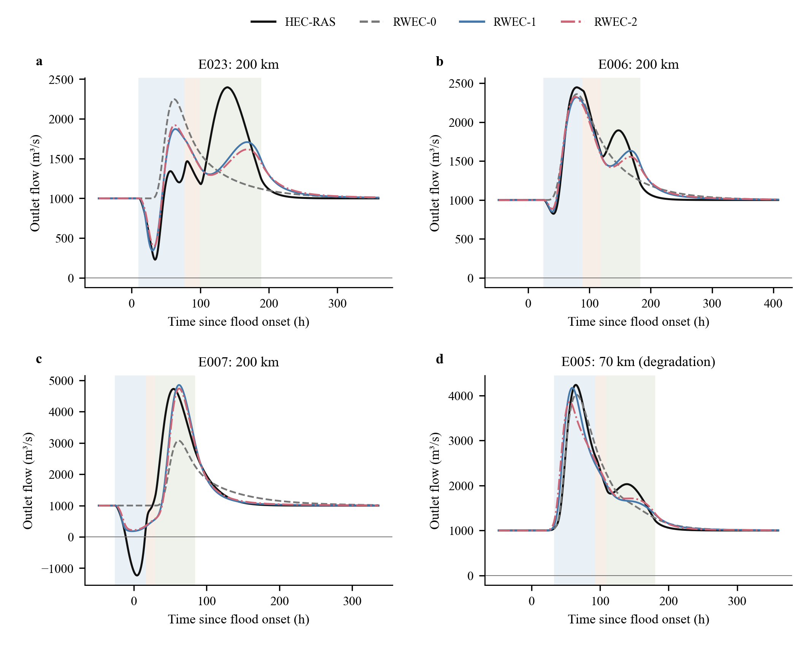
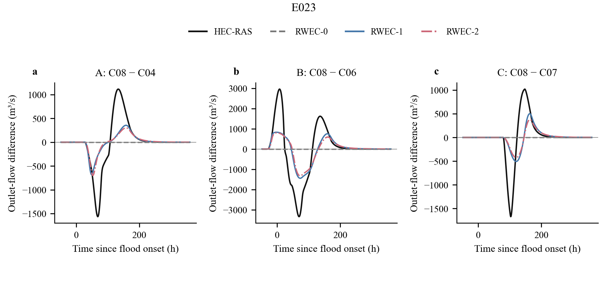
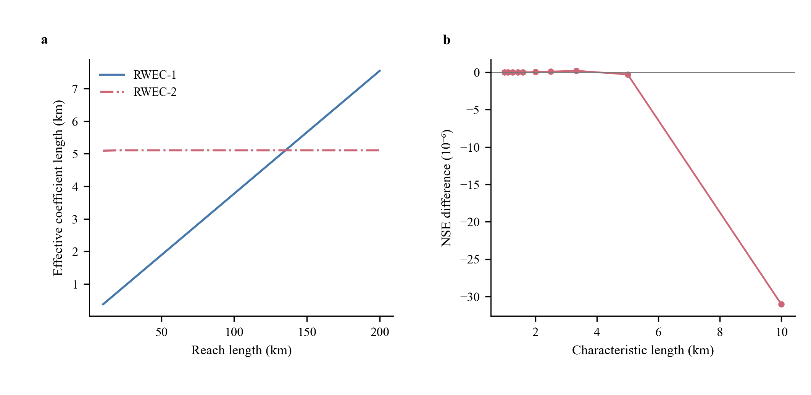
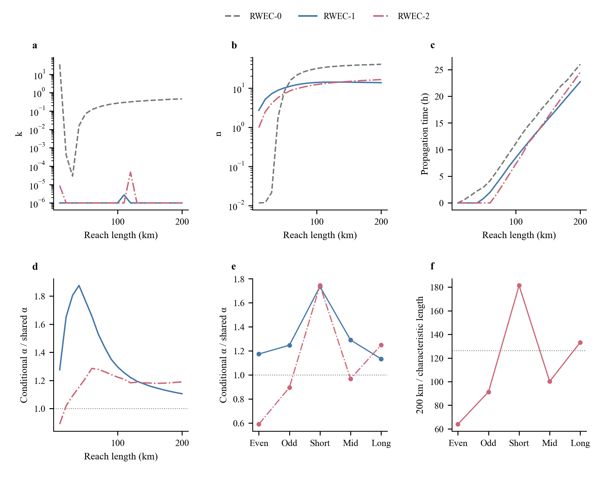
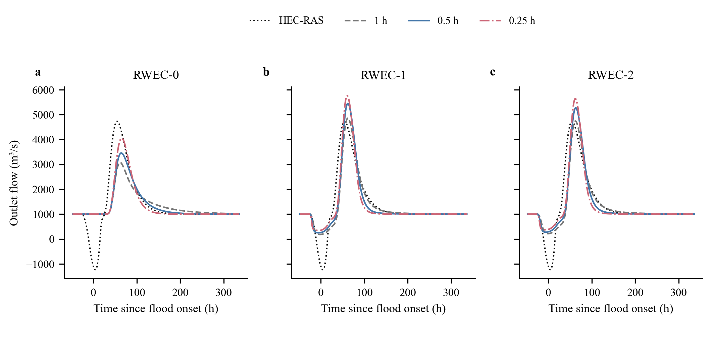

# 动态回水潜在滞蓄修正的首轮比较

在现有70场开发洪水中，将下游水位和河长加入潜在滞蓄项，能够明显改善出口流量的整体拟合。线性修正已获得主要改善；饱和河长修正的全局平均指标略高，却未在长河段、消落恢复阶段和条件参数检验中表现出稳定优势。当前证据支持继续研究动态下游边界约束，但不足以冻结RWEC-2作为最终公式，更不宜据此直接宣称已具备独立入库洪水预报能力。

本轮严格采用用户文档给定的三参数基准及两项候选修正。核对现有论文后，三参数结构与论文中的T-RWEC一致，较早档案曾称其为LMCS；另一套两参数原始RWEC没有被混入本轮。三模型的完整方程、单位、初始状态、滞后插值及内部水量平衡见 [METHODS.md](METHODS.md)。新增项作用于潜在滞蓄约束，并未将HEC几何附加蓄量代入预测。

主率定只使用70场开发洪水，每个河长的原有k、n、tau在事件间共享，新增alpha和ell进一步在全部事件与河长间共享。30场测试目标未读取。原始HEC工程、既有流量结果和第一阶段成果均保持原状。三个模型分别完成70×20组开发演算，以及未再次率定的32×20组控制演算，所有预测均为有限值，倒流、退化和参数边界结果全部保留。

| 模型 | 自由参数总数 | 开发集平均NSE | 开发集NSE中位数 | 平均KGE | 平均RMSE / (m³/s) |
|---|---:|---:|---:|---:|---:|
| RWEC-0 | 60 | 0.68705 | 0.78111 | 0.64841 | 363.90 |
| RWEC-1 | 61 | 0.85099 | 0.89337 | 0.77590 | 257.91 |
| RWEC-2 | 62 | 0.85579 | 0.89643 | 0.78645 | 253.89 |

这里先对事件等权，再对20个河长等权。1400个事件—河长组合共享出口目标并且相互嵌套，不能当作1400场独立洪水。各项主要指标的平均、中位数、最小、最大及逐场原值均已导出，表中只列便于比较的中心指标。

相对于基准，RWEC-1在1319个组合中改善NSE、81个组合退化；RWEC-2分别为1298和102个。因而改善覆盖多数开发组合，并非只由少量优例推动，但修正也并非处处有效。RWEC-2相对于RWEC-1的平均NSE仅增加0.00480，配对改善中位数为0.00087；778个组合改善、622个退化，均未将这些相关组合用于显著性推断。按河长取平均，饱和修正的优势主要出现在中等距离，而140—200 km的结果反而较差。

| 模型 | 200 km平均NSE | 200 km平均KGE | 200 km平均RMSE / (m³/s) |
|---|---:|---:|---:|
| RWEC-0 | 0.58619 | 0.55836 | 439.26 |
| RWEC-1 | 0.82895 | 0.79326 | 280.39 |
| RWEC-2 | 0.80893 | 0.76651 | 295.99 |

完整过程比单一NSE更能说明结构的作用与不足。预定的E023、E006、E007展示了水位抬升时出流受抑以及随后释放的形状差异。RWEC-1、RWEC-2能够产生基准没有的响应，但E023消落期的二次出流峰仍明显不足，E007的真实负出流也无法再现。另按预定规则保留开发事件E005，并展示其退化最明显的70 km结果：NSE由基准0.97206降至线性修正0.94489、饱和修正0.90823。该例没有从汇总或图中删除。

在200 km河段，水位上涨阶段的逐事件RMSE中位数由702.37降至366.75、359.03 m³/s，维持阶段由365.83降至187.93、190.96 m³/s，说明两种修正对出流受抑阶段确有帮助。水位消落阶段也由564.24降至342.30、379.31 m³/s，但仍存在较大残差。边界水位恢复后的中位RMSE却由68.93增至76.54、83.89 m³/s。该阶段三个模型的逐事件平均偏差中位数依次为+52.26、+53.26、+62.78 m³/s，表明恢复后普遍偏高，饱和修正没有消除这一系统偏差。不能将全过程NSE的改善解释为释放过程已经得到正确描述。

## 相同洪水背景下的边界响应

32项控制计算未参与主率定，所有模型用固定参数演算。完整200 km入口的洪水过程相同，基准不接收下游水位，因此其不同边界条件间的预测出流差接近零；这是检验新增边界项是否真正产生响应的直接位置。短河段入口流量自身已受到下游边界影响，即使基准不显式输入水位也可能产生差值，不能将短河段表现单独归因于新增项。

将每种因素的16项固定其他条件的对比汇总，在200 km处得到如下出口差值过程RMSE均值。A为幅度3→6 m，B为上涨起点−0.25D→+0.25D，C为维持0→0.20D，后者也延后退水起点。单位为m³/s。

| 因素 | RWEC-0 | RWEC-1 | RWEC-2 |
|---|---:|---:|---:|
| A：水位幅度 | 475.81 | 417.03 | 415.43 |
| B：上涨时机 | 776.18 | 557.39 | 580.26 |
| C：高位维持 | 231.25 | 198.42 | 198.52 |

两种修正都能产生有别于零响应的出流差值，并降低三类响应的平均误差，因此它们获得的不只是整体洪水过程的数值改善。然而响应幅度仍明显不足，部分峰谷时刻也不对齐。RWEC-1的三类差值NSE均值只有约0.24、0.40、0.17，RWEC-2约为0.24、0.38、0.22，远低于其绝对流量过程的平均NSE。饱和修正在上涨时机对比的200 km均方误差上弱于线性修正，维持对比也没有一致优势。可以说模型捕捉到部分边界响应，但还不能说已经正确描述了完整入库差值过程。

四个洪水背景的全部48项条件差值、20个河长和所有小时输出均保留；图中固定展示C08−C04、C08−C06、C08−C07三个条件对比，避免只展示最有利的对比。其余三个背景的图见 [E006](figures/control_response_E006.pdf)、[E007](figures/control_response_E007.pdf)、[E069](figures/control_response_E069.pdf)。这些背景均来自开发集，不能作为独立洪水验证。

## 参数含义与当前解释边界

RWEC-1的统一alpha为0.0377369。RWEC-2得到alpha=3.22011、ell=1585.15 m，两者乘积约为5104.35 m。由于最短研究河长已经是10 km，该ell使饱和项在整个研究范围内几乎成为常数；这并不是识别到了第一阶段所观察的几十至上百千米的实际影响长度。潜在约束参数和几何回水范围本来就不是同一个量，本轮结果尤其不支持将两者等同。

保持原参数以及alpha·ell不变，仅把ell在1—10 km范围内改变，平均NSE仍位于0.855759—0.855791，最大变化约0.000031。该条件敏感性扫描没有替换主率定解，也没有追加优化；它表明alpha与ell存在很强的补偿，当前资料和目标对单独的ell约束很弱。饱和形式多得到的少量平均精度，不能被解释为一个稳定可辨识的物理长度。

原有参数的表现也要求谨慎：RWEC-1有19个河长的k命中预定下界，RWEC-2有18个。这说明新增项加入后，率定倾向于用它替代原有k所控制的潜在滞蓄贡献，而不是在一个已被稳定识别的原机制上增加小修正。下界没有为追求更高精度而向外扩张。

固定主要原参数后，RWEC-1在两个35事件组中的条件alpha约为0.0443、0.0471，在短、中、长河长组中约为0.0655、0.0487、0.0428；RWEC-2的条件ell约为1.10—3.12 km，同时alpha明显改变。共享参数在数学上可以用于所有事件和河长，但这些条件诊断尚未证明具有稳定、唯一的物理值。原参数使用过全开发资料，故这些分组结果不是独立交叉验证；主优化在最后一轮仍有改善，条件重估与主解的差异也可能包含尚未达到联合驻点的影响。

三模型采用相同的49600次单河长目标评价当量上限，实际计入的次数为40892、42796、43312。相同上限不表示实际次数完全相同；新增参数的优化成本和自由度均已列出。4轮结束时RWEC-1、RWEC-2平均NSE仍分别比前一轮提高约0.0096、0.0094，因此本轮只说明固定预算内找到了这些解，没有证明全局最优，也没有为让某个模型获胜而延长搜索。

将参数固定，在现有小时输入的线性插值上改用0.5、0.25 h计算，并将细时段出流平均回1 h，三模型仍有明显差异。对4个预定洪水背景的10、100、200 km组合，0.25 h结果相对于1 h结果的RMSE均值约为137.21、137.50、136.51 m³/s。基准本身也依赖步长，因而不能把差异全部归因于新项；但将不随时段缩放的体积项加到逐时潜在蓄量中，也不能仅凭量纲正确就认为具有步长不变的物理解释。本轮没有改变公式或暗中缩放alpha来消除差异，三模型结果的适用口径仍限于固定1 h的开发比较，尚未通过跨步长可移植性检查。

70场开发洪水中有36场出现出口负流量，合计733个小时输出样本，最小值约−2757.27 m³/s。三模型沿用非负出流结构，无法再现这些时段。仅由非负约束导致的NSE理论上界，在这些70场完整序列上平均约为0.98154，最低约为0.86621。这个界限解释了一部分不可达误差，却不能解释所有残差，更不能为消落和恢复偏差开脱。负滞后平均入流的截断次数亦已按模型、事件和河长记录，原始输入未被删除。

本轮已经回答了最初的两个问题：加入下游水位约束能够改善开发集绝对出流，并捕捉部分同场边界差值；非线性饱和长度项尚未显示比线性项更稳定、更合理的证据。恢复阶段偏差、参数补偿和步长依赖仍未解决。依照本轮停止条件，计算与结果整理到此结束，不开启30场测试，不构造新的候选公式。

全部可追溯材料位于 [tables](tables)、[predictions](predictions) 和 [provenance](provenance)。其中逐事件全指标见 event_length_metrics.csv，主要指标四种汇总统计见 metric_summary.csv，阶段统计见 phase_event_metrics.csv及phase_summary.csv，参数见parameters.csv，全部条件差值指标见control_response_metrics.csv。图注见 [FIGURE_LEGENDS.md](FIGURE_LEGENDS.md)，复算入口见 [REPRODUCE.md](REPRODUCE.md)。
