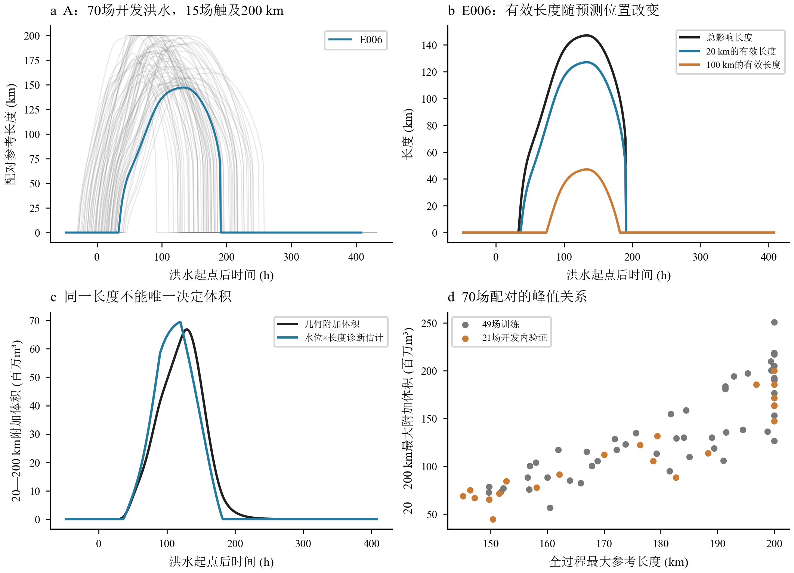
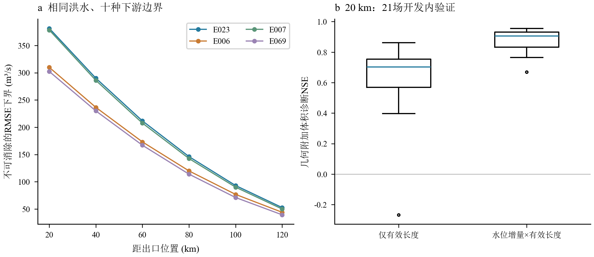
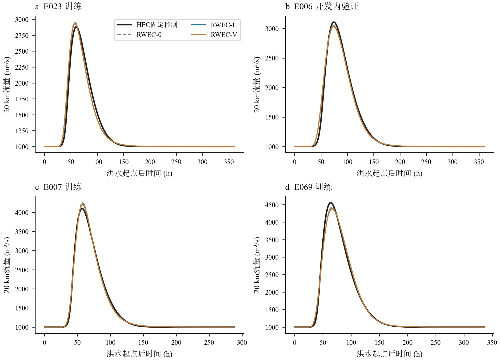
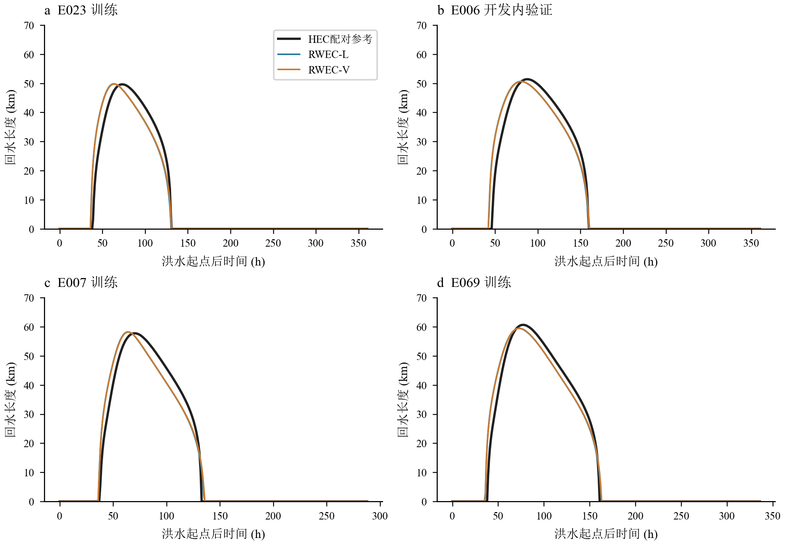
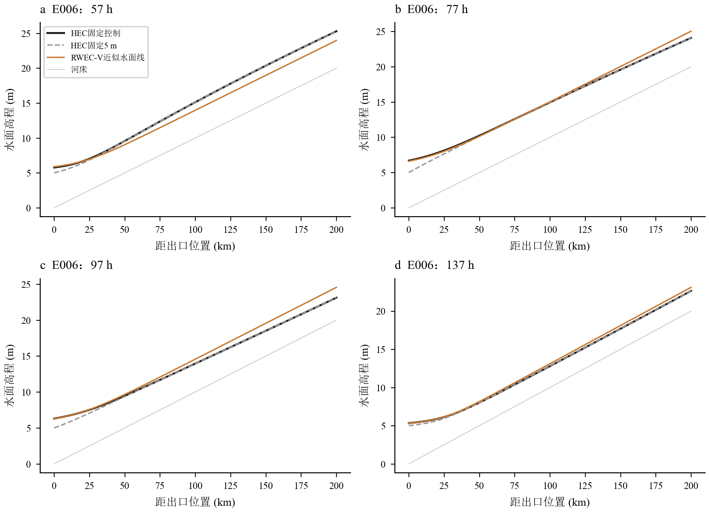
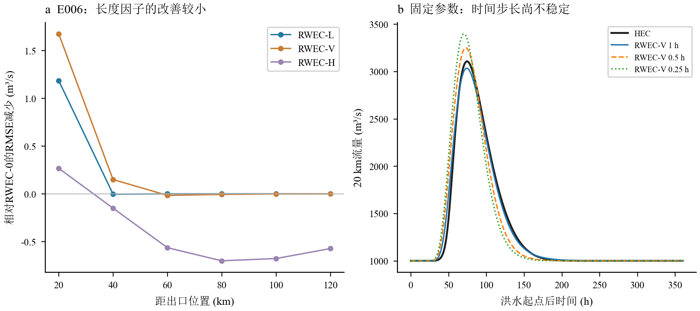

# 未知未来水位条件下的RWEC动态回水长度：机理分析与四场先导研究

2026年10月22日。先导研究；实验B未扩展正式样本，30场封存测试未启用。

已有独立水位强迫实验和新建固定控制河槽给出了不同的信息条件。前者表明，同一上游洪水不能唯一确定受未知外部水位影响的出流；后者则允许通过已知控制关系，在模型内部闭合出口水位和回水长度。本轮已经完成这一因果闭合，但还没有形成可推广的新演进公式。四场先导的1 h演算具有较高流量精度，长度预测也接近水动力参考；与此同时，固定参数换步长后精度明显下降，长度因子的独立流量收益有限。现阶段应保留原型与这些反例，先解决离散时间尺度，再考虑扩大实验。

## 信息条件与水动力依据

实验A使用原70场开发配对及32个控制结果，沿用49场训练、21场开发内验证。A没有重新运行HEC，所有172个原始流量结果文件和70个既有差值文件在分析后均通过哈希及修改时间核验。固定5 m配对和真实内部剖面用于确定评价目标，未被送入自主原型。相同规定上游输入的场景从洪水起点前48 h的共同物理初态比较；部分边界在洪水起点前已涨水，因此这里的不可辨识性不应解释为已知$t=0$完整内部状态后的条件结论。计算保留原始负流量，20 km目标在70个动态场景内共有468个负流量保存样本。

实验B为独立200 km工程，底宽500 m、边坡3、糙率0.025、床坡0.10‰、断面间距2 km、计算步长60 s、常规输出1 h。基流1000 m³/s、出口初始水位5 m；采用24 h稳态预热及洪水前48 h已知过程。预先选定的四场洪水如下，原事件编号与分组保持不变。原随机水位参数在B中不生效，B只继承其上游洪水过程。

| 事件 | 用途 | Qp_m3s | D_h | r |
|---|---|---|---|---|
| E023 | 训练 | 3443.343 | 113.404 | 0.283 |
| E006 | 开发内验证 | 3468.929 | 153.572 | 0.306 |
| E007 | 训练 | 5053.635 | 106.271 | 0.308 |
| E069 | 训练 | 5144.766 | 150.527 | 0.264 |

首场计算前冻结的出口控制为

$$H_0(Q_0)=3.5+1.5(Q_0/1000)^{2/3}\quad[\mathrm m].$$

它对应堰顶3.5 m、自由堰流系数1.7和有效宽度320.195 m的理想单值控制。HEC实际使用0—12000 m³/s的固定评级曲线，未输入人为未来水位过程，也未设置水库库容或调度。1—4 m涨幅只是设计目标，四场结果没有反向用于调整几何或控制。通用单值评级曲线不能代表任意自然河道的水位流量滞回，也没有检验淹没控制；本工程的适用前提是规定的固定水力控制。评级边界含义参见[HEC官方边界说明](https://www.hec.usace.army.mil/confluence/rasdocs/rasum/latest/performing-a-1d-unsteady-flow-analysis/entering-and-editing-unsteady-flow-data/boundary-conditions)。旧生成器附带的boundary.csv中control工况的stage_m=5列只是初始占位，实际生效边界以冻结u01中的静态Rating Curve为准；没有使用该列驱动求解。

四场各配一个固定5 m参照，共8次计算，全部完成保存时窗、初始化、原生流量积分水量平衡、湿断面、查表覆盖和退水恢复检查。全河段均无倒流，最小流量999.988 m³/s，最大水深7.611 m，控制边界表关系的最大水位残差0.000150 m。原生平衡残差须相对储量变化判断，逐工况完整指标保存在工程质量文件，摘要见[B_HEC_quality.csv](tables/B_HEC_quality.csv)。这只是先导基本数值质量；新B工程尚未完成1 km空间或30 s水动力敏感性检验，不能据此宣布正式实验全部数值关口通过。

| 事件 | 出口涨幅_m | 最大参考长度_km | 最强抑流20km_m3s | 最大恢复20km_m3s | 最大附加体积20至200km_百万m3 |
|---|---|---|---|---|---|
| E023 | 1.526 | 49.642 | -74.470 | 29.407 | 5.318 |
| E006 | 1.686 | 51.402 | -66.903 | 26.778 | 5.831 |
| E007 | 2.326 | 57.756 | -121.423 | 41.441 | 7.654 |
| E069 | 2.611 | 60.652 | -112.333 | 36.783 | 8.572 |

四场实际出口涨幅为1.526—2.611 m，落在预定目标范围内；相对于固定5 m参照，回水造成20 km处约67—121 m³/s的最大流量抑制，退水时出现约27—41 m³/s的恢复增流。流量、体积差都是带符号配对差值，恢复过程没有被截为零。

## 实验A：回水末端、附加体积与不可辨识性

在0.10 m正水位差阈值下，70场参考回水最大长度约145—200 km，其中15场触及200 km，实际更远的末端不可从当前域内断言。有效长度随预测位置变化；它与从200 km至目标断面的总演算长度不是同一个量。阈值之外仍有小水位差，几何体积又是沿程积分，因此有效长度为零时也可能存在百万m³量级的剩余体积差。

长度本身不能唯一决定附加体积。仅用有效长度的几何诊断，在20 km的21场开发内验证上平均NSE为0.626；加入水位增量乘积后为0.881。两者均使用真实配对长度及已知边界，属于几何规律诊断，不是仅输入上游流量的预报，更不能把其回归增益直接当作RWEC潜在滞蓄转换系数。完整各位置、逐场及分布结果见[A_geometric_diagnostic_metrics.csv](tables/A_geometric_diagnostic_metrics.csv)。20 km附加体积的过程滞回也说明简单矩形项不能表达所有剖面记忆。

四个背景各有固定5 m、原动态边界和八个补充控制场景，共十种未来边界。对于这些相同规定入流和初态，任一确定性上游单输入模型只能给出同一条预测，因而存在下表的经验误差下界。等权是有限场景集合的分析约定，不代表现实发生概率。NSE上限用各场景方差分母加权求得，与均方误差最优的过程均值不同。

| event_id | xc_km | optimal_pooled_RMSE_floor_m3s | minimax_saved_point_error_floor_m3s | mean_NSE_ceiling |
|---|---|---|---|---|
| E006 | 20 | 309.797 | 1036.244 | 0.728 |
| E006 | 100 | 76.806 | 321.050 | 0.981 |
| E006 | 120 | 44.010 | 195.780 | 0.994 |
| E007 | 20 | 378.274 | 1322.825 | 0.790 |
| E007 | 100 | 90.101 | 468.157 | 0.987 |
| E007 | 120 | 50.020 | 284.161 | 0.996 |
| E023 | 20 | 381.363 | 1326.536 | 0.580 |
| E023 | 100 | 93.100 | 436.929 | 0.964 |
| E023 | 120 | 52.644 | 263.226 | 0.988 |
| E069 | 20 | 302.237 | 966.120 | 0.892 |
| E069 | 100 | 71.102 | 317.561 | 0.994 |
| E069 | 120 | 39.373 | 179.712 | 0.998 |

20 km经验最优RMSE下界为302—381 m³/s，100 km为71—93 m³/s，120 km为39—53 m³/s。最大单个保存时点误差也有非零下界，不能靠选择另一组RWEC参数同时消除。上述信息边界使用各组共同完整保存时窗，含洪水前48 h和退水尾部；未扣除稳态段后重新包装为更高精度。严格推导见[方程与因果性说明](EQUATIONS.md)。理想场景均值本身使用未来响应，只能构造数学下界，不能作为预报方案。

在A中另做了不率定的已知外部水位水力诊断：用上游洪水代表流量和真实边界水位计算渐变流，再按初始特征传播时间延迟。21场开发内验证的长度RMSE均值由无延迟的26.09 km降为21.48 km，但仍明显大于B。该结果说明传播记忆有作用，同时暴露强回水、非均匀流和倒流下均匀代表流量近似的不足。由于A确实使用真实未来水位，这一计算不是自主预报；A也没有足够信息构建唯一固定出口控制关系。

## 自主原型与初步对照

原型把全河道离散为十个20 km子段，所有段共享$k,n,\tau$。上游洪水始终从200 km输入，内部断面输入来自模型上一段的预测。出口0 km的预测流量通过固定控制换算水位，不能用20—120 km的内部流量冒充出口流量。每步联合迭代出口流量、水位和长度，0.5阻尼、最多80次；流量固定点差$10^{-4}$ m³/s、水位变化$10^{-6}$ m、长度变化1 m作为同时收敛门槛。初始状态由已知稳态和互补平衡方程确定，没有读取HEC未来状态帮助收敛。

渐变流水面线与同流量固定5 m水面线比较，初始上行特征速度给出的空间传播时间用于因果历史延迟，最后由0.10 m差值求最远影响长度。L修正使用边界涨幅乘有效长度，V修正积分预测水面线之间的面积差，二者单独率定，未叠加。潜在项中已加入的几何代理没有再作为独立实际储量计入水量平衡。

三场训练洪水的固定5 m参照流量用于共享核心参数率定，目标包括六个指定断面及出口，各洪水和位置等权。随后冻结核心，仅在三场固定控制动态工况中分别率定每个候选的一个增益。E006没有参与任何率定，A/B未混合拟合。参数表如下；每个目标位置都用同一组参数，未作逐位置率定。

| model | k | n | tau_per20km_h | alpha | train_events | validation_events |
|---|---|---|---|---|---|---|
| RWEC-0 | 0.020929 | 3.572076 | 2.192039 | 0.000000 | 3 | 1 |
| RWEC-L | 0.020929 | 3.572076 | 2.192039 | 0.005592 | 3 | 1 |
| RWEC-V | 0.020929 | 3.572076 | 2.192039 | 0.020924 | 3 | 1 |
| RWEC-H | 0.020929 | 3.572076 | 2.192039 | 0.001250 | 3 | 1 |
| RWEC-1（真实未来水位） | 0.020929 | 3.572076 | 2.192039 | 0.000431 | 3 | 1 |

RWEC-H由内部预测水位驱动，但对每段使用完整20 km长度，作为长度消融。RWEC-1输入真实未来出口水位，仅是理想信息回算。它的固定整段修正结构不一定优于所有其它结构，不能把下表中的有限模型精度称为严格信息上限。历史SR2/SR3也不列入自主预报组。

训练三场及验证一场在六个位置的平均指标如下。训练平均涵盖18条相关过程，验证平均涵盖同一E006的六个相关位置，不能当成18或6场独立洪水。KGE使用相关性、标准差比和均值比；峰时按1 h保存网格确定，精细到小时以下的结论不成立。逐场全部指标含NSE、RMSE、KGE、洪峰及峰时误差，见[B_event_metrics.csv](tables/B_event_metrics.csv)，各位置的均值、中位数、最小和最大值见[B_metric_summary.csv](tables/B_metric_summary.csv)。

| subset | model | NSE | RMSE_m3s | KGE | peak_error_pct | peak_time_error_h |
|---|---|---|---|---|---|---|
| train | RWEC-0 | 0.99471 | 52.25843 | 0.99041 | 0.81092 | 0.50000 |
| train | RWEC-1（真实未来水位） | 0.99473 | 52.14237 | 0.99064 | 0.66192 | 0.50000 |
| train | RWEC-H | 0.99479 | 51.93058 | 0.99046 | 0.37673 | 0.50000 |
| train | RWEC-L | 0.99481 | 52.05227 | 0.99077 | 0.58064 | 0.50000 |
| train | RWEC-V | 0.99481 | 52.07545 | 0.99074 | 0.66465 | 0.50000 |
| validation | RWEC-0 | 0.99579 | 39.22526 | 0.98436 | -1.46063 | 0.00000 |
| validation | RWEC-1（真实未来水位） | 0.99576 | 39.39120 | 0.98269 | -1.61821 | 0.00000 |
| validation | RWEC-H | 0.99572 | 39.62486 | 0.97965 | -1.92592 | 0.00000 |
| validation | RWEC-L | 0.99584 | 39.02831 | 0.98344 | -1.60859 | 0.00000 |
| validation | RWEC-V | 0.99587 | 38.92538 | 0.98346 | -1.57070 | 0.00000 |

最受回水影响的20 km验证断面为：

| model | NSE | RMSE_m3s | KGE | peak_error_pct | peak_time_error_h |
|---|---|---|---|---|---|
| RWEC-0 | 0.99269 | 51.92587 | 0.98164 | -1.85897 | 0.00000 |
| RWEC-L | 0.99302 | 50.74087 | 0.97753 | -2.48548 | 0.00000 |
| RWEC-V | 0.99316 | 50.25147 | 0.97787 | -2.32726 | 0.00000 |
| RWEC-H | 0.99277 | 51.65869 | 0.97533 | -2.53954 | 0.00000 |
| RWEC-1（真实未来水位） | 0.99269 | 51.93303 | 0.97936 | -2.10355 | 0.00000 |

E006的RWEC-L和RWEC-V分别将RMSE从51.93降到50.74和50.25 m³/s；六个位置平均RMSE从39.23降到39.03和38.93 m³/s。改进幅度有限，40 km以上多数位置几乎不变。整段长度RWEC-H在开发内验证多数位置略有退化，说明限制修正的空间范围有合理性，但现有四场不能确立长度因子具有稳定、显著或可迁移的独立价值。原RWEC本身已有较高1 h精度，不宜仅凭小数位NSE改善宣布新方法成立。

四场RWEC-L长度RMSE约2.98—3.50 km，RWEC-V约2.92—3.38 km；E006分别为3.50和3.38 km。这个长度没有采用HEC真实末端作为输入，也没有针对长度指标率定参数。不过增益率定的流量会通过出口闭合间接影响长度，因此不能把长度误差看作完全独立于流量率定的证据。参考长度是两个非恒定配对场景的实际水位差，模型长度是单一代表流量下的准恒定差再加记忆，二者概念一致但动力近似不同。

## 守恒、因果性和失效边界

四场小时原型均完成迭代，最多22次，无不收敛或查表带外点；各子段离散水量残差最高约$5.6\times10^{-9}$ m³，独立累计的延迟在途体积平衡残差最高约$4.3\times10^{-6}$ m³。它们验证了算法记账，不能证明RWEC状态就是几何河槽储量。级联接口还须区分时段平均出流与梯形输入求积，这一限制已在方程说明中写明。每次约0.007—0.012 s的修正模型计算时间不含首次编译、查表预计算、率定和文件输出，不能用它推断全部研究耗时。

改变24 h之后的未来上游输入，各自主模型24 h以前的结果完全不变；函数接口没有未来水位参数，真实水位只在独立oracle封装内。稳态1000 m³/s保持试验及零增益恢复RWEC-0试验通过。这里的因果性是相对于已提供的上游预报过程而言，当然不能由尚未取得的未来上游洪水做确定预报。

固定参数的时间步长检查没有通过。E006在20 km的RWEC-V：1 h NSE=0.99316，0.5 h降为0.95446，0.25 h降为0.89294；后两者相对于1 h过程的RMSE分别97.44和166.12 m³/s。所有细步长轨迹仍收敛，所以这不是迭代失败。原互补式的稳态储量随$\Delta t$变化，有限$n$下单步互补映射又不自动形成连续时间极限；在这一结构未处理前，小时率定参数不能宣称具有跨步长物理稳定性。完整敏感性指标没有通过重新率定掩盖。

这套最小水力闭合目前仅在已知固定单值控制、温和亚临界正向流、已知稳态初始条件和本先导范围内有证据。独立外部水位、库调度变化、淹没控制、临界或超临界状态、明显倒流、非均匀流量及洪水快速变化，都会破坏当前闭合或准恒定代表流量近似。A的强回水诊断误差已经提供了具体反例；其它失效域尚未系统采样，不能用四场成功替代失效概率研究。

不知道未来下游水位还能预测多准确，需要先区分边界。A中只有条件误差下界，没有唯一自主确定性真解；B中固定控制使预测可闭合，本先导的小时验证NSE约0.993—0.998，但只有一场开发内验证。长度因子的独立价值目前表现为空间解释及小幅局部改善，证据尚不足。A到B沿用了同一几何方程、阈值和传播构造，未率定水力长度参数，说明规则可以被实施到两种坡度；由于A须提供真实外部水位，不能据此宣称自主预报模型已完成独立跨场景迁移。失效条件既包括信息缺失，也包括水力近似失效和已证实的时间离散尺度失效。

目前适合保留四场先导、不扩充正式HEC样本。优先研究原互补递推的时间尺度一致化，在固定参数下重新通过步长检验后，再用增加的独立开发事件检验长度相对RWEC-H、无记忆水力长度等消融的价值。是否扩大正式实验由研究者在审阅本轮结果后决定，30场封存测试继续保留。

## 阅读与复核

[完整方程、单位、守恒及信息下界推导](EQUATIONS.md) · [冻结方案](PROTOCOL.md) · [参数表](tables/B_parameters.csv) · [长度逐场指标](tables/B_length_metrics.csv) · [数值与因果性检查](tables/B_numerical_causality_checks.csv) · [时间步长逐场结果](tables/B_timestep_sensitivity.csv)。

本次按2026年10月22日的最新要求交付静态图表，不再制作动画。执行范围修订见[SCOPE_UPDATE_20261022.md](SCOPE_UPDATE_20261022.md)。完整HEC/HDF、101断面过程与高分辨率图件保存在移动硬盘；阅读仓库包含报告、方程、关键小表和PNG预览。报告内公式保留可编辑LaTeX，图件中文SimSun、西文与数字Times New Roman。
