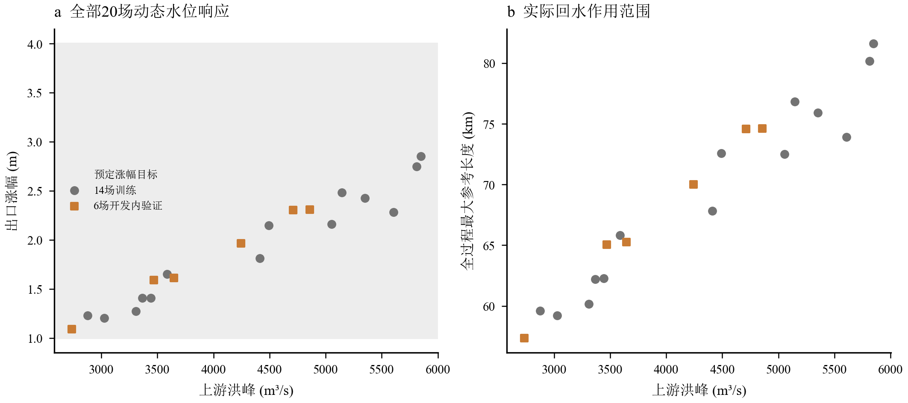
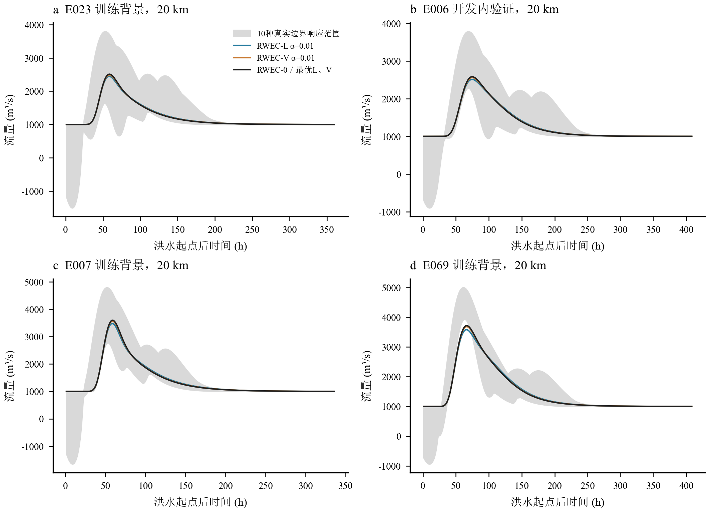
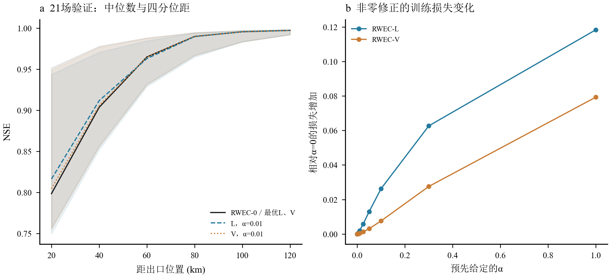
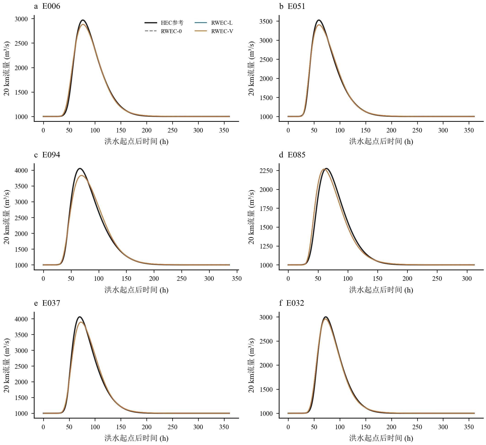
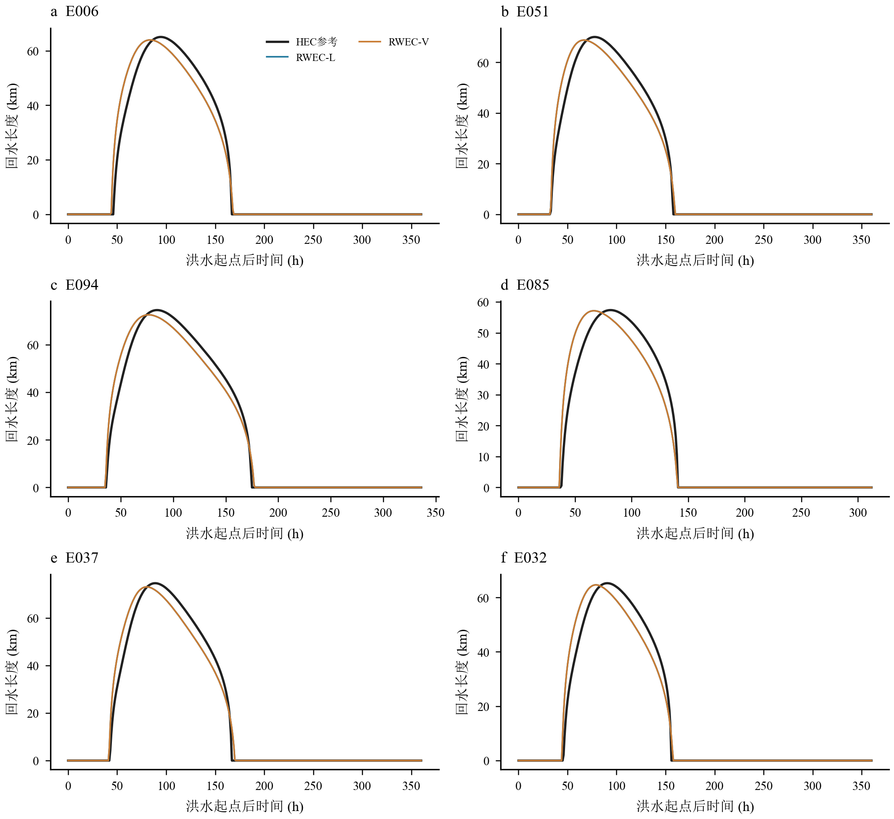
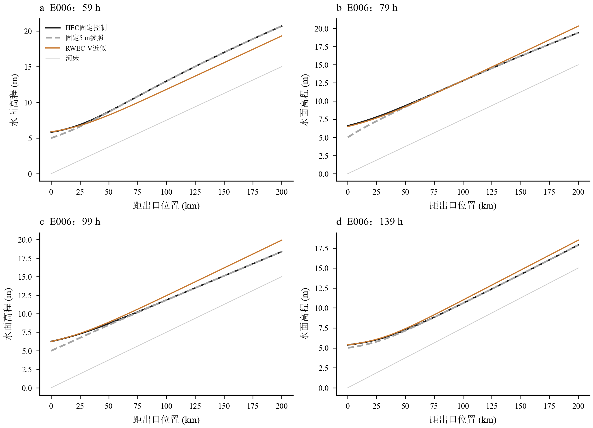
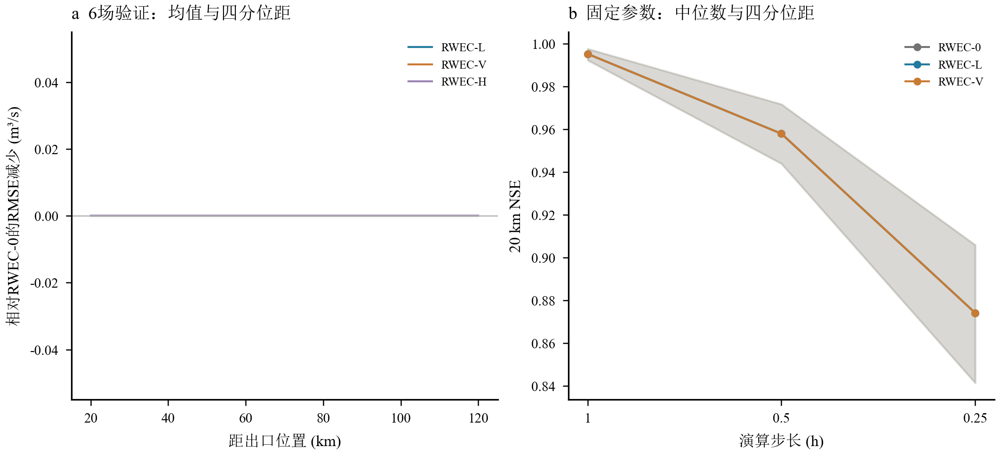

# 旧河道实际洪水演算与0.075‰河槽二十组HEC先导结果

2026年10月22日。已完成实际求解、洪水演算、逐场评价及静态图件；未启用30场封存测试。

本轮完成了旧200 km河道70场开发洪水的172条配对和补充控制场景评价，以及新0.075‰河槽20组配对先导、40次主求解和4次时间／空间检查。RWEC-0、L、V、整段长度H消融及真实未来水位oracle均实际执行，A另做5 m持续边界和固定非零增益压力试验。计算没有因既有时间步长问题中止。主要结果是：固定控制下可以自主预测动态回水范围，但在让原RWEC获得同等训练输出信息后，本轮简单正向潜在项修正没有保留非零共享增益。高流量NSE不能用来证明长度修正的独立价值。

## 实验对象与验证信息

新河槽为200 km、坡度0.075‰、底宽500 m、边坡3、糙率0.025、2 km断面、60 s计算、1 h保存。初始流量1000 m³/s、出口初始水位5 m，冻结的单值控制为

$$H_0(Q_0)=3.5+1.5(Q_0/1000)^{2/3}\quad[\mathrm m].$$

它是已知的理想堰流型评级关系，并未建立水库库容、调度或实体淹没堰模型。未来水位不作为时间序列输入HEC或自主RWEC；HEC的静态评级表在求解前已固定，自主模型由自己的出口流量求水位。涨幅1—4 m是设计目标，没有根据本20场未来结果反调参数。20组每组包含固定控制和固定5 m参照，共40次主计算。前四背景保留，余下依入流洪峰、历时、峰现比例的归一化最远点规则选取；14场来自原49训练集，6场来自原21开发内验证集，未访问原30场封存结果。

20组均已完成并通过本轮初始化、原生流量体积积分水量平衡、边界误差、断面覆盖和退水恢复检查。新河槽实际出口涨幅1.088—2.851 m，参考回水最大长度57.36—81.61 km，全河段最小流量999.930 m³/s，无裁剪流量操作。20 km处最大抑流约68.86—167.48 m³/s，退水恢复增流约29.41—54.68 m³/s。

E023另计算30 s时间步长和1 km空间间距，各含控制／参照两条，共4次附加HEC计算。相对于较细设置，原2 km／60 s在六个内部位置的最大RMSE为0.195 m³/s，峰值相对差的最大绝对值0.0222%，最大水面差0.001131 m；四次均通过基本质量检查。这是代表事件的数值敏感性证据，不能当作所有未采样水力状态均已验证。40场主计算原生平衡残差相对储量变化最大约0.00255%。完整质量、分组及四个细化过程见[B_HEC_quality.csv](tables/B_HEC_quality.csv)、[B_HEC_numerical_sensitivity.csv](tables/B_HEC_numerical_sensitivity.csv)。

旧A没有重跑HEC。其已有固定5 m、独立3—6 m涨幅过程和32次控制输出全部保留为评价真值，仍用49训练／21开发内验证。A不存在唯一已知的出口控制，因此实际执行两种诚实的无未来水位闭合：5 m持续假设，以及将冻结堰流关系移植到A的压力试验。后者产生模型内部长度和体积，但控制假设与真实外部强迫不一致，不能冒称A真实固定边界。同一规定上游洪水在不同真实边界下始终使用同一条因果预测。负流量真值保留，详见[truth_reversal_by_case.csv](tables/truth_reversal_by_case.csv)。

## 公式、率定和实际演算

水能互补递推保持本工程原实现：

$$S_W=S_{i-1}+\overline I_{\tau,i}\Delta t,\qquad S_E=S_{i-1}+k\overline I_{\tau,i}\Delta t+B_i,$$
$$S_i=(S_W^{-n}+S_E^{-n})^{-1/n},\qquad \widehat Q_i=(S_W-S_i)/\Delta t.$$

L与V候选分别使用

$$B_{L,i}=\alpha B_0[\widehat H_0-5]_+L_{\mathrm{eff},i},\qquad B_{V,i}=\alpha\int\{A(\widehat y)-A(y_r)\}\,dx.$$

它们不叠加。几何面积差只是潜在项代理，不被重复加到实际储量，也不被假定等于RWEC状态。全河十个20 km子段由200 km向0 km递推，0 km预测流量闭合控制关系，再由渐变流和初始上行特征传播时间预测水面差；0.10 m阈值确定动态长度。预测函数没有真实未来水位、HEC内部出流或实际末端参数。完整单位、初始化、水量记账、迭代和信息边界推导见[EQUATIONS.md](EQUATIONS.md)。

为严格比较，本轮先让RWEC-0也在各自的训练场景输出上率定，避免只让新公式额外接触动态场景。A每个上游事件等权、同事件内两种或十种边界等权；B只用14个固定控制动态训练事件。主目标含六个指定内部位置及出口，各位置等权。随后冻结公共核心，分别率定每个正向潜在项的单一增益。还对每个模型执行同为70次目标评价预算的局部联合更新；它是同预算敏感性，不是全局最优证明。主核心先采用固定预算差分进化及局部细化，边界为$10^{-4}\le k\le20$、$0.15\le n\le150$、$0\le\tau_{20km}\le8$ h，$0\le\alpha\le1$。

A/B完全分开率定。主参数如下，所有内部位置共享相同子段参数，未逐位置另配一套最优参数。

| 河槽 | model | k | n | tau_per20km_h | alpha |
|---|---|---|---|---|---|
| A | RWEC-0 | 0.037253 | 8.444123 | 2.330558 | 0.000000 |
| A | RWEC-L | 0.037253 | 8.444123 | 2.330558 | 0.000000 |
| A | RWEC-V | 0.037253 | 8.444123 | 2.330558 | 0.000000 |
| A | RWEC-H | 0.037253 | 8.444123 | 2.330558 | 0.000000 |
| A | RWEC-1_oracle | 0.037253 | 8.444123 | 2.330558 | 0.006928 |
| B | RWEC-0 | 0.032520 | 4.337306 | 2.257981 | 0.000000 |
| B | RWEC-L | 0.032520 | 4.337306 | 2.257981 | 0.000000 |
| B | RWEC-V | 0.032520 | 4.337306 | 2.257981 | 0.000000 |
| B | RWEC-H | 0.032520 | 4.337306 | 2.257981 | 0.000000 |
| B | RWEC-1_oracle | 0.032520 | 4.337306 | 2.257981 | 0.000000 |

## 原RWEC与新公式的验证结果

下表A为21场主动态边界事件、B为6场固定控制事件，在六个内部位置的事件均值。位置之间相关，不能把A的126条或B的36条过程当作126／36场独立洪水。RWEC-1使用真实未来水位，是oracle回算；它的有限公式结构不构成所有模型性能的数学上界。

| 河槽 | 模型 | 独立洪水数 | NSE | RMSE_m3s | KGE | 洪峰误差_pct | 峰时误差_h |
|---|---|---|---|---|---|---|---|
| A | RWEC-0 | 21 | 0.92012 | 143.24367 | 0.88069 | -1.61420 | -1.49206 |
| A | RWEC-L | 21 | 0.92012 | 143.24367 | 0.88069 | -1.61420 | -1.49206 |
| A | RWEC-V | 21 | 0.92012 | 143.24367 | 0.88069 | -1.61420 | -1.49206 |
| A | RWEC-H | 21 | 0.92012 | 143.24367 | 0.88069 | -1.61420 | -1.49206 |
| A | RWEC-1_oracle | 21 | 0.91801 | 165.99245 | 0.82661 | -9.64907 | -0.13492 |
| A | RWEC-1_oracle_joint | 21 | 0.93622 | 148.53645 | 0.89841 | -7.32300 | 3.42857 |
| B | RWEC-0 | 6 | 0.99585 | 39.97661 | 0.98535 | -1.95196 | 0.61111 |
| B | RWEC-L | 6 | 0.99585 | 39.97661 | 0.98535 | -1.95196 | 0.61111 |
| B | RWEC-V | 6 | 0.99585 | 39.97661 | 0.98535 | -1.95196 | 0.61111 |
| B | RWEC-H | 6 | 0.99585 | 39.97661 | 0.98535 | -1.95196 | 0.61111 |
| B | RWEC-1_oracle | 6 | 0.99585 | 39.97661 | 0.98535 | -1.95196 | 0.61111 |
| B | RWEC-1_oracle_joint | 6 | 0.99585 | 39.97661 | 0.98535 | -1.95196 | 0.61111 |

本轮冻结主目标下，L、V和H的最优共享增益均取0；局部联合更新没有找到更好的非零自主解，因此它们的主流量过程与RWEC-0相同。这个结果不是没有执行新公式：A额外完成了$\alpha=0.01,0.05$的所有场景实际演算，两河槽均完成0至1的非零增益网格；详细过程误差、稳定性和训练损失见[A_nonzero_gain_stress_metrics.csv](tables/A_nonzero_gain_stress_metrics.csv)、[A_alpha_grid_by_event.csv](tables/A_alpha_grid_by_event.csv)、[B_alpha_grid_by_event.csv](tables/B_alpha_grid_by_event.csv)。单个事件或位置仍可局部改善，不能据此替换整个共享目标的选择。

对不同演算长度，RWEC-0及主L/V的验证均值如下。A越靠近出口误差越大，不能用上游位置较高的NSE掩盖出口附近的未知强迫；B则在已知控制下有较高小时精度。

| 河槽 | xc_km | NSE | RMSE_m3s | KGE |
|---|---|---|---|---|
| A | 20 | 0.79740 | 300.57484 | 0.75059 |
| A | 40 | 0.86838 | 213.69358 | 0.81155 |
| A | 60 | 0.92290 | 144.31852 | 0.86846 |
| A | 80 | 0.95969 | 94.18228 | 0.92125 |
| A | 100 | 0.98099 | 62.40943 | 0.95930 |
| A | 120 | 0.99136 | 44.28337 | 0.97300 |
| B | 20 | 0.99336 | 49.59381 | 0.97948 |
| B | 40 | 0.99441 | 45.10353 | 0.98388 |
| B | 60 | 0.99544 | 42.24092 | 0.98500 |
| B | 80 | 0.99640 | 38.89065 | 0.98604 |
| B | 100 | 0.99732 | 34.58935 | 0.98776 |
| B | 120 | 0.99817 | 29.44138 | 0.98995 |

训练网格提示不同位置对增益的偏好不同，V在某些远端位置取较大的网格端点但总体改善很小。因此另做只含六个指定内部断面、排除出口误差权重的率定敏感性，重新率定原RWEC并分别搜索L/V，仍只用训练事件。该分支由训练诊断触发，属于探索性权重检查，不替换冻结主结果，也没有按验证精度挑选参数。其结果如下；L/V仍未保留非零共享增益，说明主结论不只是额外出口权重造成的。

| 河槽 | 模型 | NSE | RMSE_m3s |
|---|---|---|---|
| A | RWEC-0_six_targets | 0.92075 | 143.40228 |
| A | RWEC-L_six_targets | 0.92075 | 143.40228 |
| A | RWEC-V_six_targets | 0.92075 | 143.40228 |
| B | RWEC-0_six_targets | 0.99577 | 41.39229 |
| B | RWEC-L_six_targets | 0.99577 | 41.39229 |
| B | RWEC-V_six_targets | 0.99577 | 41.39229 |

位置增益网格与边界命中见[A_position_alpha_stability.csv](tables/A_position_alpha_stability.csv)、[B_position_alpha_stability.csv](tables/B_position_alpha_stability.csv)。仅强制各位置共享参数不能证明参数稳定；本轮边界命中及零增益正是需要保留的可辨识性结果。

## 长度、水面线与迁移检验

B的六场验证，内部计算长度RMSE为3.809—4.726 km，均值4.145 km；出口水位RMSE约0.0207—0.0778 m。L/V增益虽然为零，内部水力状态和长度仍由各自预测出口过程计算，未使用真实末端，因而可以独立评价水力模块。它的长度精度不能自动转化为附加潜在项的流量增益。

绝对水面线仍使用单一出口代表流量的准恒定基准，与非均匀非恒定HEC剖面存在偏差。几何体积代理逐位置的误差单独列于[A_profile_volume_errors.csv](tables/A_profile_volume_errors.csv)、[B_profile_volume_errors.csv](tables/B_profile_volume_errors.csv)，不将它们称为RWEC潜在储量真值。A阈值长度还有200 km右删失和可能不连通影响区，不能把最远超阈值点一概解释为连续传播波前。

另实际进行了A参数到新B的零重率定迁移，不混合两套目标。B六场验证中，迁移原参数的平均NSE=0.96668、RMSE=124.48 m³/s，明显弱于在B独立训练后的结果。由于A学得的L/V增益为零，该检验不能证明非零长度作用可迁移，只说明共享参数未经重率定的表现。完整逐场和长度结果见[A_to_B_zero_refit_transfer.csv](tables/A_to_B_zero_refit_transfer.csv)、[A_to_B_zero_refit_length.csv](tables/A_to_B_zero_refit_length.csv)。

## 信息边界、守恒与失败范围

四个十边界背景的同一入流不可辨识性重新按洪水起点后共同保存时窗计算。20 km的等权经验RMSE下界为305.77—391.50 m³/s。它们以洪水前48 h的相同物理初态为条件；误差从$t=0$以后统计，并不意味着提供了不同场景在$t=0$的完整内部状态。有限场景等权也不是现实概率。任何自主确定性模型都不能同时命中同一输入下的所有不同真实响应，详见[A_information_bounds_flood_window.csv](tables/A_information_bounds_flood_window.csv)。

两河槽主模型均无记录的不收敛或查表带外步，最大迭代23次。子段离散平衡和延迟在途体积平衡达到浮点误差量级；独立累计的在途体积平衡最大残差分别约7.15e-06、5.48e-06 m³。它们验证算法记账，不证明算法状态等于HEC几何储量。级联接口的时段平均／梯形求积差也须按方程说明处理。改变24 h以后的上游输入，全部自主模型此前的结果不变；真实水位只进入标明的oracle。数值失败表与输入核验见[provenance/verification.json](provenance/verification.json)、[provenance/causality_check.json](provenance/causality_check.json)。

固定参数时间步长检验依然失败。下表取20 km各验证洪水均值；主L/V退化为原模型，因此具有相同变化。没有用各步长重新率定掩盖这种结构差异。

| 河槽 | dt_h | NSE | RMSE_m3s | 与1h过程差_RMSE_m3s |
|---|---|---|---|---|
| A | 1.00000 | 0.79740 | 300.57484 | 0.00000 |
| A | 0.25000 | 0.63311 | 393.04630 | 254.36989 |
| A | 0.50000 | 0.74621 | 329.21075 | 136.26370 |
| B | 1.00000 | 0.99336 | 49.59381 | 0.00000 |
| B | 0.25000 | 0.85829 | 234.33421 | 246.96526 |
| B | 0.50000 | 0.94902 | 135.13195 | 144.10376 |

已知固定单值控制、初态稳态和温和亚临界正流使B的水力闭合可用；独立外部水位、未知调度、淹没控制、明显倒流、近临界或超临界状态、快速变化和沿程非均匀流量仍可能使当前模型失效。A已包含实际倒流反例，B20场无倒流不能代表那些状态已经通过验证。时间离散不一致是已经证实的另一项失效，而不是HEC求解失败。

本轮因此回答了四个研究问题：无未来水位时，A存在不可消除的信息误差，B在本固定控制样本的1 h演算可以取得较高精度；简单长度／体积附加项在同等训练信息下未显示稳定独立增益；零重率定迁移已计算但不支持非零长度因子跨河槽成功的结论；水力闭合、未知外部强迫和时间尺度均构成明确适用限制。它们是实际运行得到的结果，不把高NSE、参数取零或计算返回成功替代方法成立的证据。

## 完整结果入口

主指标表：[A逐模型文件索引](tables/A_metric_file_index.csv)、[B逐模型文件索引](tables/B_metric_file_index.csv)。本地A合表含12384行，阅读仓库按模型拆分以保留全部逐场内容；不存在因大文件限制丢掉低精度事件。另有洪峰与峰时、抑流恢复、长度、水位、几何体积、参数、数值及步长表。两河槽从未混合率定，原70／30及49／21分组保留。

[全部逐场静态图册](FIGURE_ATLAS.md)包含A全部21场主动态验证洪水的六位置过程及B全部20场的流量／长度过程。英文、数字和数学符号Times New Roman，中文SimSun，PDF/SVG保留文字，方程保留可编辑LaTeX；本轮无动画。原始HEC/HDF和完整预测过程保留在移动硬盘，阅读包保存正文、关键表格和PNG。工程control工况旧boundary.csv中的stage_m=5只是生成器初始占位，实际施加边界以冻结u01静态Rating Curve为准。
