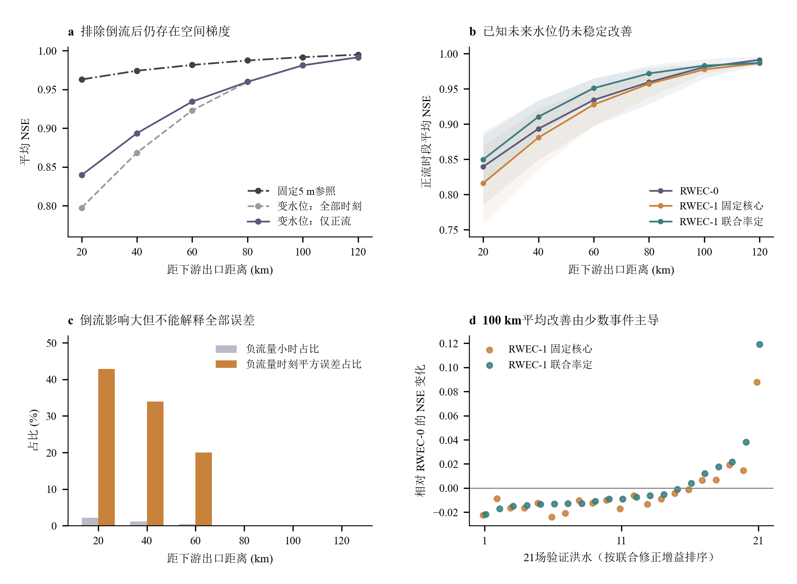
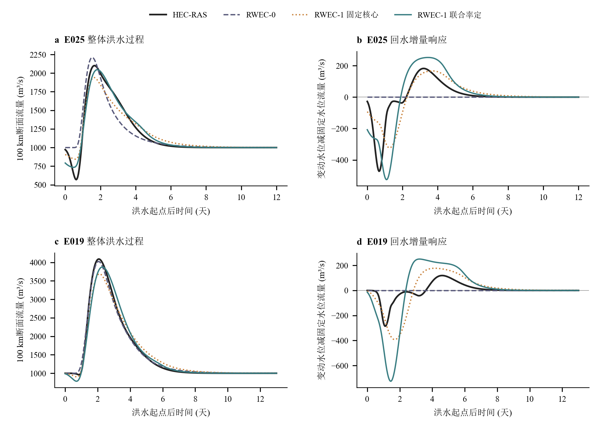

# 正流条件下的旧河槽演算与线性水位修正复核

2026年10月23日。本轮已按用户要求，对旧河槽原21场开发内验证洪水完成实际冻结模型复算和逐时筛选；没有重新率定、没有新增HEC计算，30场封存测试未读取。用户确认的“线性模型”为RWEC-1线性水位修正。下面的“100 km”均指距下游出口100 km的预测断面，入流固定在200 km处，实际演算长度为100 km。

旧河槽100 km处RWEC-0精度较高，并非由负流量的评价方式造成。对既有70场开发洪水及控制场景的172条过程，100 km处所有已保存小时均无负流量；本轮21场主变水位洪水也全部为正，最小流量544.75 m³/s。因此，删除负流量对这里的任何指标都没有影响。上一轮主指标已经从洪水起点后t≥0统计，洪水前48 h初始化输出没有进入该指标。本轮读取的42条主配对过程均通过原初始化检查；部分外部水位在洪水起点前已经变化，其造成的物理响应不能作为数值启动误差删除。

“稳态后”在本次主比较中具体取初始化后的洪水过程，再按用户要求只评价真实Q≥0的保存时刻。各模型先完整递推，之后使用相同掩码评分，不在倒流处截断输入或重置状态。另列最后一个负值小时之后，以及再缓冲12 h后的连续过程。后两者仅表示倒流已结束，不证明河流已恢复水力稳态。真正洪水结束后趋近1000 m³/s的常流尾段，无法单独检验洪水传播能力，接近常量时NSE也会受极小分母影响。

| 距出口距离/km | RWEC-0 全过程NSE | 排负后NSE | 排负后RMSE/(m³/s) | 固定5 m参照NSE |
|---:|---:|---:|---:|---:|
|20|0.79740|0.83948|242.56|0.96277|
|40|0.86838|0.89343|184.03|0.97401|
|60|0.92290|0.93426|133.57|0.98151|
|80|0.95969|0.95969|94.18|0.98724|
|100|0.98099|0.98099|62.41|0.99154|
|120|0.99136|0.99136|44.28|0.99473|

表内每项均为先逐事件计算、再对21场等权平均；参照列使用固定5 m工况完整洪水窗口，严格相同时刻的参照指标另见表格中的reference_common_nonnegative。20 km处7293个洪水后保存小时中有155个负值，占2.13%，这些时刻占21场汇总平方误差的42.87%。剔除它们后仍保留较大的正流误差，平均RMSE为242.56 m³/s；即使只取倒流结束再缓冲12 h的连续窗口，平均NSE也仅为0.84817。40 km和60 km处的负值时刻分别占汇总平方误差的33.96%和20.02%。80 km在这21场主洪水中已经没有倒流，但NSE仍低于100 km。原模型不能表达负出流是明确限制，但不能据此解释全部下游误差。

固定5 m参照在20 km处的NSE为0.96277，而变水位正流段为0.83948，说明基本传播误差和外部回水响应需要同时区分。不同位置的演算长度本身也随位置改变，不能把整个空间梯度都归因于单一水力机制。配对固定/变动水位结果提供了同一位置、同一入流下边界影响的直接证据。

100 km处高NSE的主要含义是主体洪水过程可以由上游来流和基础蓄泄关系较好演算。NSE的定义为

$$\mathrm{NSE}=1-\frac{\sum_t(\widehat Q_t-Q_t)^2}{\sum_t(Q_t-\overline Q)^2}.$$

该位置21场洪水的全过程标准差约349—933 m³/s，而固定/变动水位的配对流量差RMS逐场平均为48.23 m³/s，配对差绝对峰值逐场平均为169.78 m³/s。回水响应仍然存在，但在多数事件中小于主体洪水变化尺度，整体NSE可以保持很高。此外，第五阶段RWEC-0已在49场训练洪水的两类边界输出上率定，其参数能够吸收平均传播和平均边界效应。它没有未来水位输入；这属于训练分布内的参数拟合，不能解释为模型已经辨识了每个事件的真实外部水位。

为直接检验边界响应，应另计算

$$\Delta Q_b(t)=Q_{\mathrm{var}}(t)-Q_{\mathrm{ref}}(t),\qquad \Delta\widehat Q_b(t)=\widehat Q_{\mathrm{var}}(t)-\widehat Q_{\mathrm{ref}}(t).$$

对于相同上游输入和同一初态，RWEC-0在两种未知外部边界下给出同一条预测，因此其预测增量恒为0。100 km处回水增量的平均NSE约为0，尽管整体流量NSE为0.98099。两项结果并不矛盾：前者评价额外的边界响应，后者主要评价整个洪水过程。

本轮严格保留第五阶段的公共级联核心，先比较只增加线性修正的结果，再列已有联合率定结果。下表均为100 km断面的21场正流过程，线性两行都使用真实未来下游水位，属于已知边界回算。

| 模型 | 平均NSE | 平均RMSE/(m³/s) | 平均KGE | 平均洪峰偏差/% |
|---|---:|---:|---:|---:|
|RWEC-0|0.98099|62.41|0.95930|+0.30|
|RWEC-1，固定同一核心|0.97764|92.90|0.89500|−6.06|
|RWEC-1，已有联合率定|0.98307|82.60|0.95366|−5.22|

固定核心时，线性项使平均NSE下降0.00336，21场只有5场改善。联合率定后平均NSE比RWEC-0高0.00208，但只有6场改善，事件增益中位数为−0.00901，按洪水配对重采样10000次的均值95%区间为[−0.00835,0.01668]。这不支持稳定的普遍改善。联合版本的平均RMSE反而增加20.19 m³/s，平均洪峰有约5.22%的低估。NSE与平均RMSE排序不同，是因为前者先按每场真值方差归一化，而后者保留流量误差尺度；不能只取其中一个指标宣布线性项获胜。此处联合版本沿用上轮有限70次局部优化预算，既不是新的率定，也不是全局最优证明。

若对应此前第三阶段“100 km目标、逐演算河长单段率定”的模型，按相同t≥0正流窗口重算后，RWEC-0平均NSE为0.98119、RMSE为61.07 m³/s，RWEC-1分别为0.99030和61.56 m³/s。该版本NSE改善更明显，但只有9/21场改善，增益中位数仍为负，配对重采样区间[−0.00052,0.02210]包含0；相比同阶段均衡率定的RWEC-0，改善事件仅6/21。它在100 km处的配对响应RMSE由48.23降到46.72 m³/s，改善幅度较小，平均配对响应NSE仍为−0.72145。因此，历史较高平均NSE依然不足以证明线性修正稳定重现回水机制。旧单段与新级联的参数结构及训练目标不同，表格分开保留，不拼接成同一模型的成绩。

上图两场分别是100 km处联合线性修正NSE增益最大和最小的事件，旨在显示异质性，全部21场增益已在综合图及逐场表中列出。E025的线性修正能补充明显的抑流与恢复；E019则出现过强的抑制和恢复，使原本很好的主体过程变差。对第五阶段两种线性版本，100 km配对响应平均NSE分别为−2.003和−8.706，暴露了当前全河共享线性项在空间和时序分配上的不足。这个结果针对冻结实现和训练预算，不排除其他守恒结构或适用范围内的水位修正能够改善。

正式研究下一步应集中验证动态长度对“蓄入—释放过程”的独立贡献。现有原型已经能够在已知固定控制的新河槽内部估计水位和回水长度，但L/V的共享增益仍为0，长度预测较准尚未转化成流量改进。因而应先把长度或水面差体积作为受约束的动态状态驱动，明确储量的增加、释放和传播记忆，并检查固定参数下改变步长时的行为；再利用现有新河槽14场训练、6场开发内验证评价主体洪水、配对流量响应、洪峰/峰时和守恒。两河槽仍各自率定，旧河槽承担外部水位未知时的机理与能力边界分析，30场封存测试继续保留。出现跨事件稳定、非零且具有物理意义的长度增益后，再确定扩大正式实验与最终封存检验的规模。

完整口径见[冻结诊断方案](PROTOCOL.md)，逐场分数见[逐场指标](tables/event_metrics.csv)，负值时刻及误差贡献见[误差分解](tables/negative_error_decomposition.csv)，配对响应见[回水响应指标](tables/paired_response_metrics.csv)，已有参数和事件清单保持原样。本轮的正流选择基于计算后的真实流量，是解释误差的条件评价，不能冒充预报时已知哪些小时需要删除。
