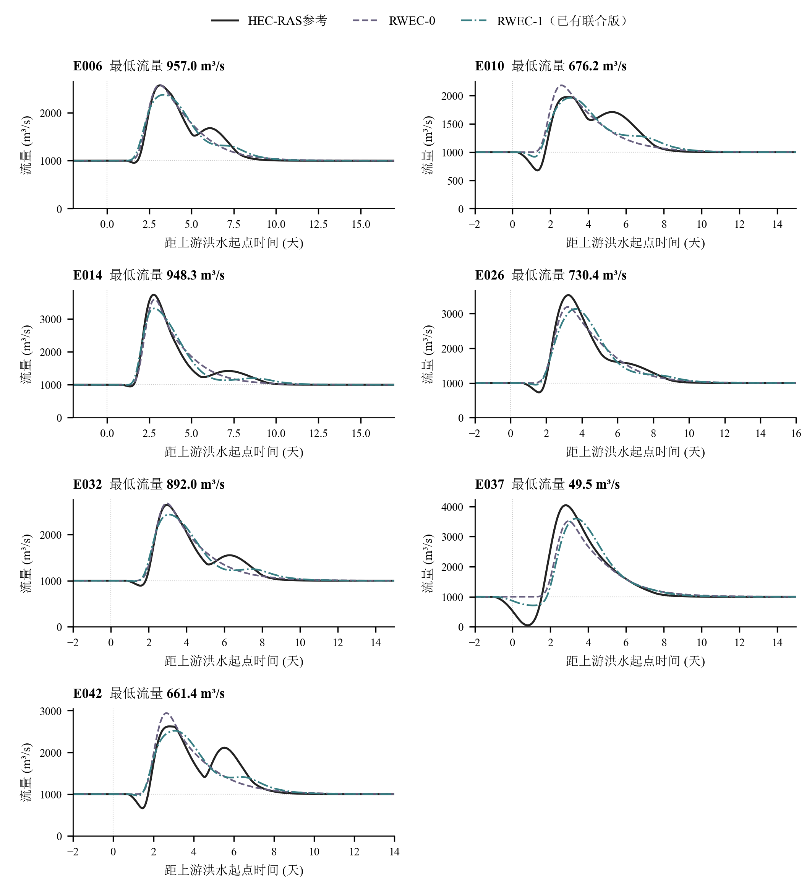
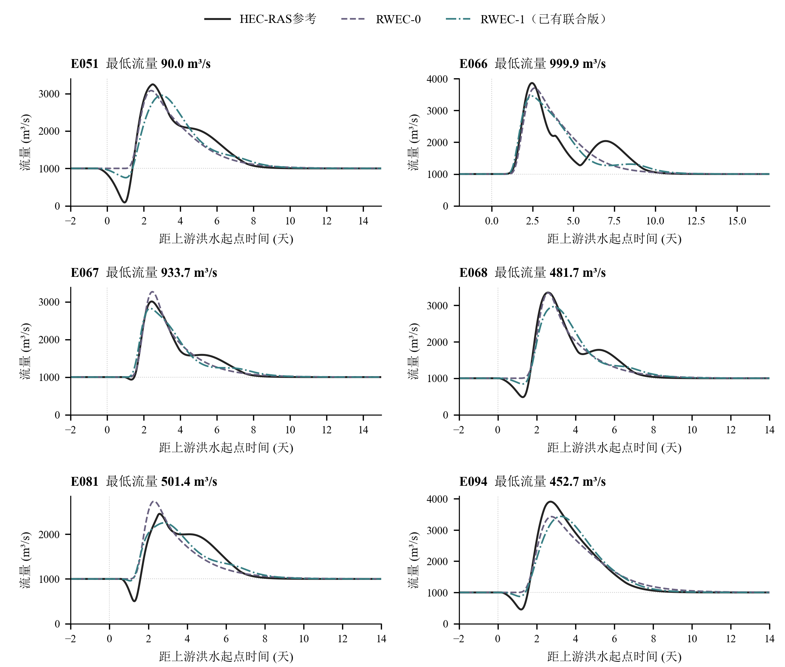

# 距下游出口20 km：用户指定13场洪水过程线

上游输入位于200 km，演算长度180 km。13场次与所给清单逐一对应；逐小时HEC最低流量取整后全部一致，所有保存小时的参考流量均为正。

黑色实线为HEC-RAS参考，紫色虚线为RWEC-0，青色点划线为已有RWEC-1联合版。后者使用真实未来下游水位，且沿用此前有限优化预算的参数；本次只提取并绘制已有结果，没有重新率定。

横轴0为上游洪水起点，负时间保留洪水前的已保存过程；没有删点、裁剪流量或重启模型状态。各图纵轴按本场流量范围显示，峰值比较应读取刻度。

| 场次：点击打开单场图 | 最低流量/(m³/s) | 最低值时刻/h | HEC洪峰/(m³/s) |
|---|---:|---:|---:|
| [E006](figures/requested13_x20_20261024/E006_x20_hydrograph.png) | 957.01 | 38 | 2573.89 |
| [E010](figures/requested13_x20_20261024/E010_x20_hydrograph.png) | 676.23 | 32 | 1975.51 |
| [E014](figures/requested13_x20_20261024/E014_x20_hydrograph.png) | 948.29 | 33 | 3734.17 |
| [E026](figures/requested13_x20_20261024/E026_x20_hydrograph.png) | 730.43 | 38 | 3537.32 |
| [E032](figures/requested13_x20_20261024/E032_x20_hydrograph.png) | 892.05 | 38 | 2642.69 |
| [E037](figures/requested13_x20_20261024/E037_x20_hydrograph.png) | 49.49 | 19 | 4041.62 |
| [E042](figures/requested13_x20_20261024/E042_x20_hydrograph.png) | 661.42 | 35 | 2621.81 |
| [E051](figures/requested13_x20_20261024/E051_x20_hydrograph.png) | 89.97 | 23 | 3246.54 |
| [E066](figures/requested13_x20_20261024/E066_x20_hydrograph.png) | 999.89 | -48 | 3864.81 |
| [E067](figures/requested13_x20_20261024/E067_x20_hydrograph.png) | 933.71 | 32 | 3009.55 |
| [E068](figures/requested13_x20_20261024/E068_x20_hydrograph.png) | 481.65 | 31 | 3349.16 |
| [E081](figures/requested13_x20_20261024/E081_x20_hydrograph.png) | 501.44 | 31 | 2456.48 |
| [E094](figures/requested13_x20_20261024/E094_x20_hydrograph.png) | 452.73 | 29 | 3909.78 |

最低值来自1 h保存点，不表示未保存的60 s求解时刻的绝对极值。

[最低流量核对表](tables/requested_13_x20_minima.csv) · [逐小时流量数据](tables/requested_13_x20_series.csv)

所有单场与总览均提供PNG、PDF、SVG及600 dpi TIFF，位于同名图件目录。原始计算和30场封存测试均未改变。
