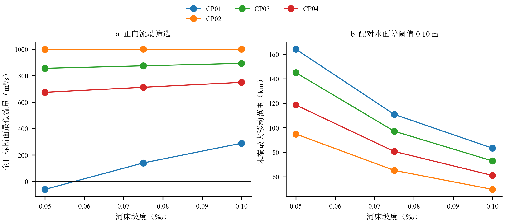
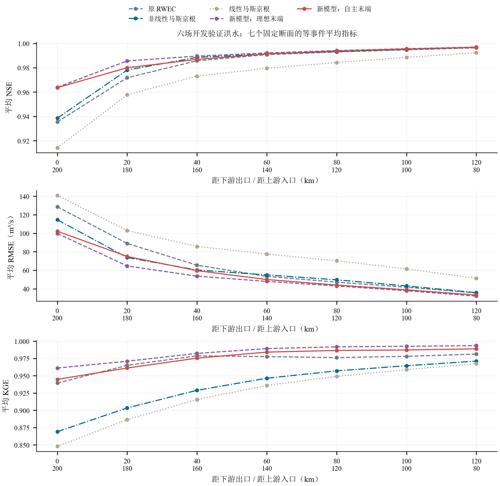
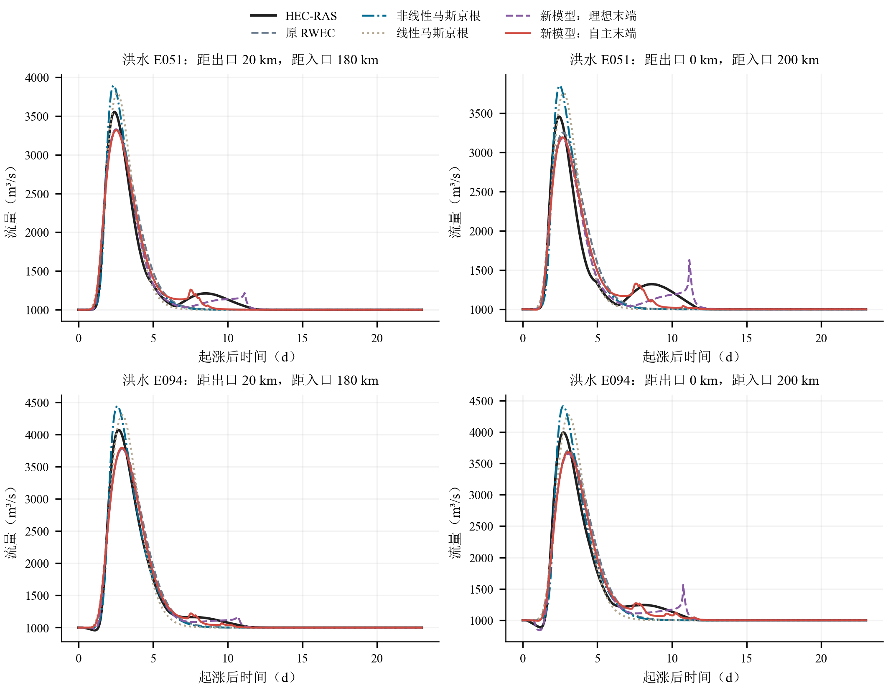
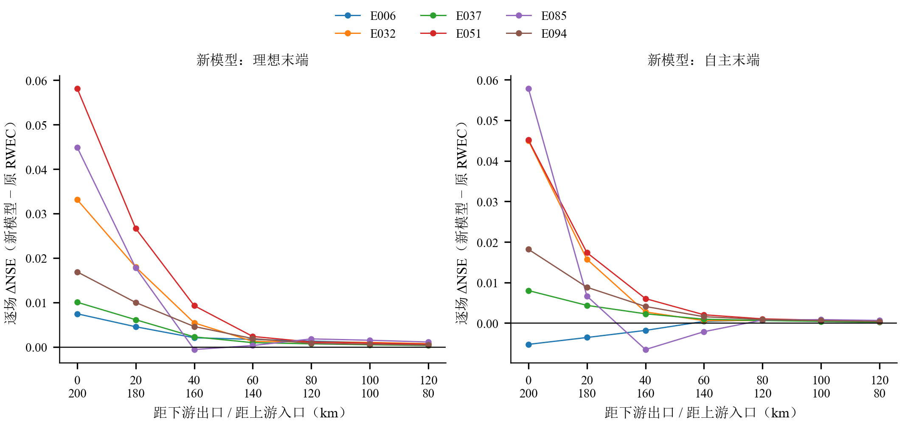
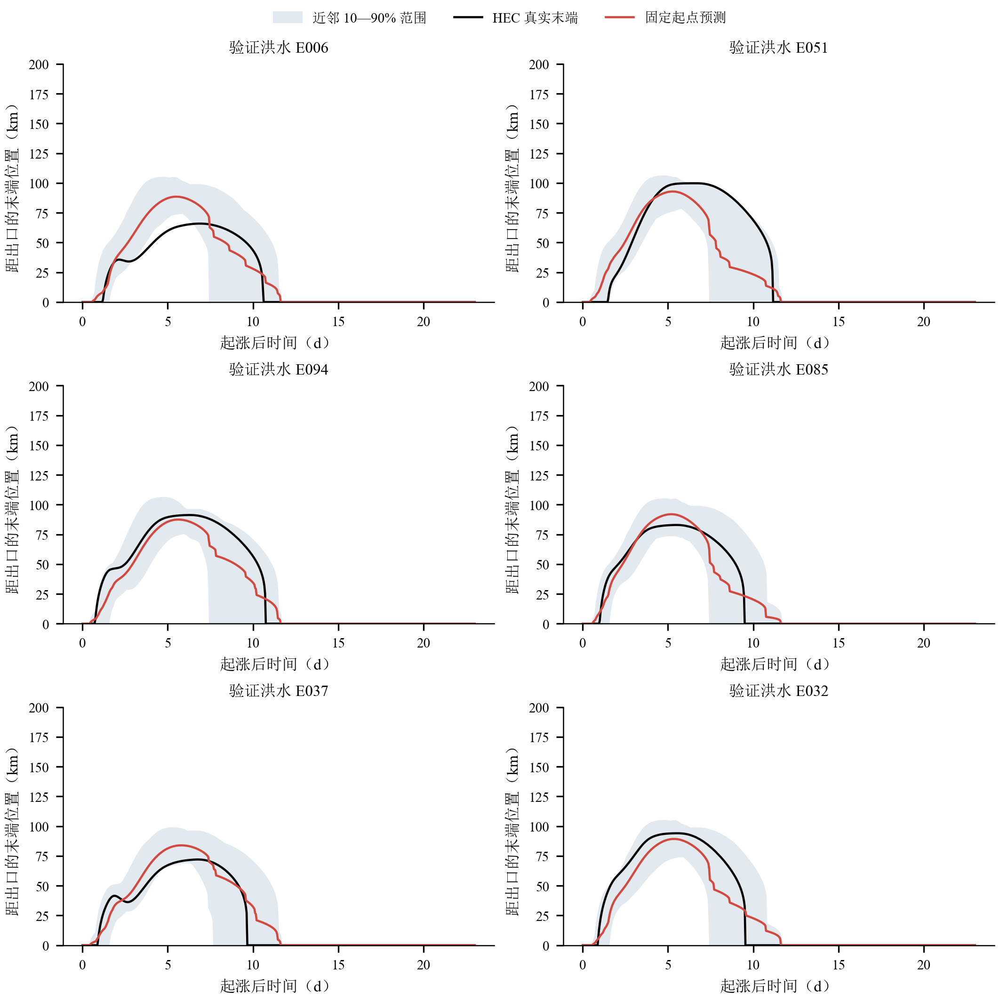
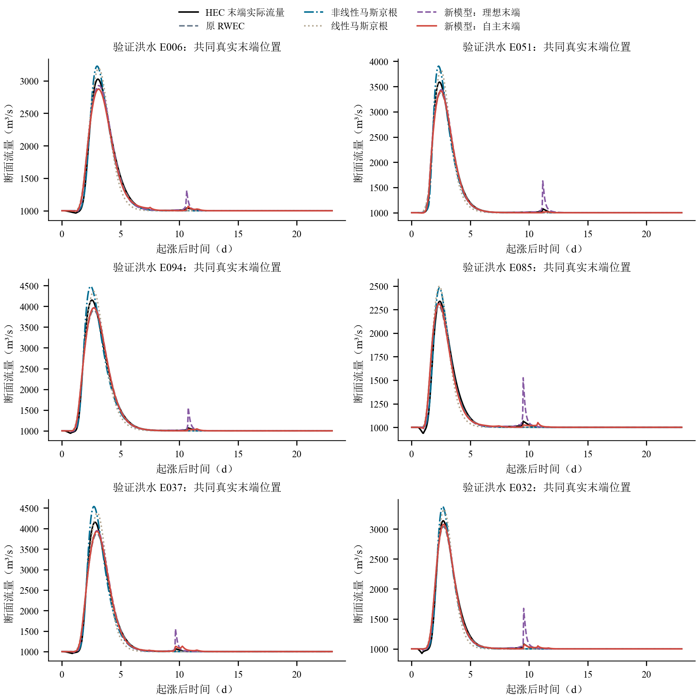
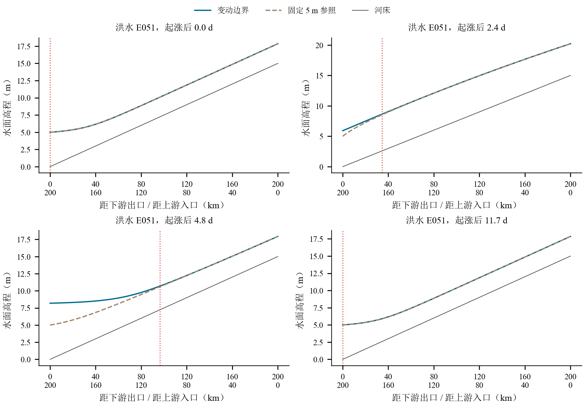
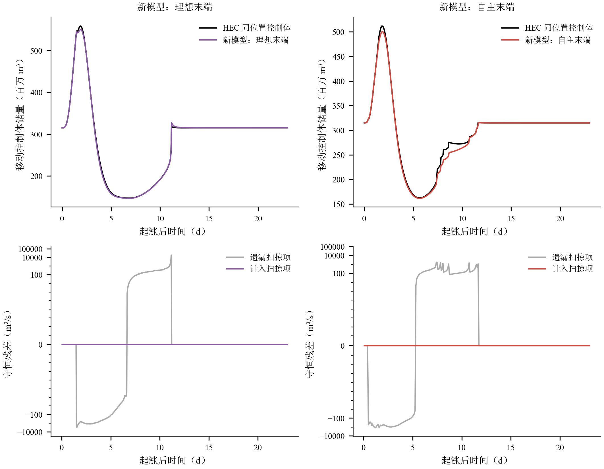
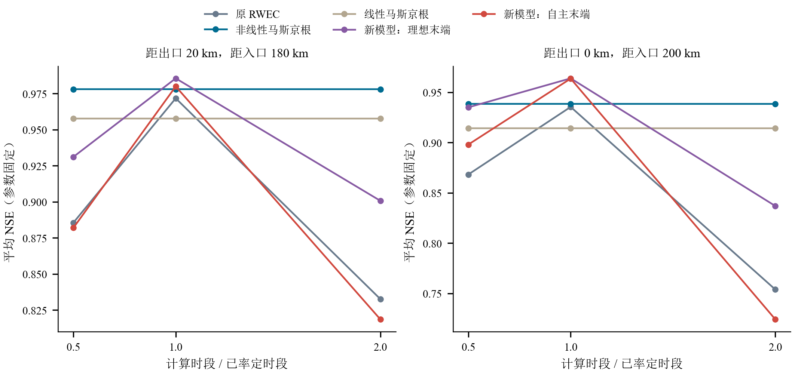

# 正向动态回水河道中的移动控制体与互补滞蓄：首轮开发验证

本轮已完成河道 C 的物理筛选、20场开发洪水的40次固定／变动水位配对计算、三种传统模型的联合率定，以及移动控制体候选的理想末端和自主末端验证。原河道 A、B 均保留，原30场封存测试读取数为0。自主模型在起点后没有读取真实下游水位、内部水面线或储量。以下结果是14场训练、6场开发内验证的首轮证据，不能称为独立封存测试结论。

七个固定断面等事件、等断面平均后，自主候选相对原 RWEC 的 NSE 改善为 0.00571，理想末端候选为 0.00718。这些均值须与逐场改善、固定参数消融和时间步长敏感性共同解释；质量守恒本身不是预测改进的证明。

**本轮判断是“存在首轮预测增益，但还不能认定新模型已稳定优于传统方法”。** 自主候选在原率定时段下改善了出口附近的完整过程与抑流／释放误差，但固定参数改变计算时段后精度明显下降；理想末端还会在阈值消失时制造释放尖峰。这两项缺陷必须先解决，不能仅凭平均NSE接近0.99扩大成功结论。

## 河槽选择及数值证据

先导包含3种坡度、4种合成洪水，每种均有固定5 m与独立变动水位工况，共24次计算。0.05‰在最不利4 m涨幅工况出现−59.52 m³/s，故保留为筛选失败；0.075‰和0.10‰相同工况分别保持140.38和289.30 m³/s的最低流量。最终选择0.075‰，原因是通过全程正流后，其20—80 km响应和末端移动强于0.10‰。筛选时没有任何RWEC或马斯京根验证分数。

最初额外要求每场先导至少两个断面同时出现50 m³/s抑流与恢复，导致三种坡度均未全部通过：1 m涨幅工况反应较弱。本轮在模型率定前作了公开的探索性修订：全部先导仍须通过数值、初始化、恢复、全目标断面正流和40 km末端移动门槛，响应强度改为河槽至少有一场在两个断面达标，再按中位响应范围排序。原无合格结果与修订记录均保存，因此这一筛选不是完全预注册的确认性结论。

河道长200 km，底宽500 m、边坡3:1、糙率0.025，初始流量1000 m³/s、出口水位5 m。上涨幅度1—4 m；上涨起点、上涨历时、维持和回落历时按固定种子独立抽样。每场固定0—552 h评价窗口，起点前48 h保持稳定，另有24 h热启动。最终20场最低流量为 746.805 m³/s，负流量样本总数为 0；40次计算的基本质量、初始化与尾部恢复通过数分别为 40、40、40。时间步长减半、空间间距减半的4次检查均通过，最大差异见数值敏感性表。

## 公平率定与固定断面结果

所有模型采用10个20 km子段，同一14／6划分、相同完整窗口和七断面平均训练NSE目标。子段采用一组共享参数，计算时段在0.25、0.5、1、2 h中联合选择；本轮没有逐个子段独立增加参数。每个模型、每种时段最多1000次目标函数评价。非线性马斯京根的储量系数、权重和非线性指数分别优化，线性模型是指数固定为1的补充基准。参数与时段均在查看验证评价之前冻结。首轮有限预算寻优不保证全局最优。

| model         |    NSE |   RMSE |    KGE |
|:--------------|-------:|-------:|-------:|
| LM            | 0.97   |  84.36 | 0.923  |
| MC_autonomous | 0.9868 |  57.53 | 0.9754 |
| MC_oracle     | 0.9883 |  54.13 | 0.983  |
| NLM           | 0.9831 |  61.73 | 0.9343 |
| RWEC0         | 0.9811 |  65.84 | 0.9709 |

重点断面结果如下。洪峰误差与峰时误差为有符号均值，可能发生正负抵消，逐场原始值另表完整保留。

| model         |   x_from_outlet_km |   distance_from_inlet_km |    NSE |   RMSE |    KGE |   peak_error_pct |   peak_time_error_h |
|:--------------|-------------------:|-------------------------:|-------:|-------:|-------:|-----------------:|--------------------:|
| LM            |                  0 |                      200 | 0.9142 | 141    | 0.8479 |            8.811 |              6.167  |
| LM            |                 20 |                      180 | 0.9577 | 103    | 0.8865 |            7.204 |              3.5    |
| MC_autonomous |                  0 |                      200 | 0.9636 | 102.2  | 0.9447 |           -6.909 |              4.667  |
| MC_autonomous |                 20 |                      180 | 0.98   |  74.96 | 0.9611 |           -5.676 |              2      |
| MC_oracle     |                  0 |                      200 | 0.9639 |  99.74 | 0.9611 |           -6.64  |              4.5    |
| MC_oracle     |                 20 |                      180 | 0.9856 |  64.67 | 0.971  |           -5.385 |              2.333  |
| NLM           |                  0 |                      200 | 0.9385 | 114.6  | 0.8691 |           10.7   |              0.8333 |
| NLM           |                 20 |                      180 | 0.9781 |  73.78 | 0.9034 |            9.163 |             -1.167  |
| RWEC0         |                  0 |                      200 | 0.9355 | 128.7  | 0.9393 |           -4.645 |              5      |
| RWEC0         |                 20 |                      180 | 0.9718 |  88.99 | 0.965  |           -5.092 |              2.667  |

代表过程按HEC在20 km处的抑流强度选取最大和中位事件，没有按候选改善幅度挑选。所有完整过程和所有验证事件的逐场改善均提供，完整窗口之外还另算0—360 h及同一固定断面的抑流、释放阶段。没有删除任何真实负流量或不利时段；若预测无效，记录失败而不裁剪或回退。固定断面无效事件—断面记录为 0。

## 末端信息与移动控制体

末端以配对水面差0.10 m的最远位置识别。20场共出现 35 个出口已低于阈值但上游仍有残留影响的输出时刻、0 个多影响区时刻和 0 个到达入口的删失时刻。这些现象保留在数据中，不将阈值边界的消失解释成无限传播速度。

自主预测沿用固定起点近邻方法，只用上游洪水预报和此前48 h水位历史。C的起点前水位恒为5 m，所以历史本身不提供未来独立强迫的信息。开发验证的末端平均绝对误差为 7.088 km，均方根误差为 12.354 km。近邻10—90%范围只是经验范围，不是经过校准的预测区间。

候选用预测末端生成一个简化空间暂存分布，并把填充或释放的水量从互补递推的本步可用水量中扣除或加入。新增参数只有空间形状系数和储量响应时标，原互补关系与原参数联合率定。移动控制体储量由模型自己的固定网格状态按剩余长度积分，不使用未来HEC储量。完整推导见 [可编辑方程](EQUATIONS.md)。初始几何体积属于已知起点状态；新增几何闭合是待验证假设，不能把几何附加储量直接宣称为RWEC潜在滞蓄。

所有模型均在同一个真实末端位置插值评价物理断面流量，另在同一个自主预测位置评价，并报告“预测位置上的预测流量”对“真实位置上的真实流量”的端到端误差。这三类指标分开保存。理想末端的高精度若出现，也不属于自主预报成果。

| model         |    NSE |   RMSE |    KGE |
|:--------------|-------:|-------:|-------:|
| LM            | 0.9787 |  74.7  | 0.9395 |
| MC_autonomous | 0.9896 |  52.63 | 0.9711 |
| MC_oracle     | 0.9859 |  60.68 | 0.9794 |
| NLM           | 0.9908 |  54.17 | 0.9488 |
| RWEC0         | 0.9886 |  56.05 | 0.9683 |

移动水量平衡采用边界扫过的单元体积积分。计入扫掠项的离散恒等式可接近机器精度，时刻流量梯形积分仍保留时间求积误差；两者分别报告。几何储量误差检验模型内部状态是否具有物理可信度，不能由代数闭合替代。下表统计六场验证结果。

| model         |   moving_RMS_m3s |   no_sweep_RMS_m3s |   sampled_flux_RMS_m3s |   storage_RMSE_million_m3 |   runtime_s |
|:--------------|-----------------:|-------------------:|-----------------------:|--------------------------:|------------:|
| LM            |        8.006e-08 |              403.7 |               0.003886 |                     8.839 |   0.0009168 |
| MC_autonomous |        5.78e-12  |              373   |               0.3631   |                     3.768 |   0.0003459 |
| MC_oracle     |        1.199e-11 |              841.1 |               2.181    |                     2.991 |   0.0005511 |
| NLM           |        2.248e-07 |              403.5 |               0.005748 |                     5.26  |   0.002639  |
| RWEC0         |        5.826e-12 |              363.9 |               0.2239   |                     3.88  |   0.0003399 |

## 机制价值、失败与解释边界

为区分新增机制和重新调参带来的作用，固定每个候选已率定参数，仅关闭新增暂存项。对应有无该项的开发验证均值如下；这项消融比单独比较重新率定后的总NSE更直接。

| model         |   NSE_with |   NSE_without |
|:--------------|-----------:|--------------:|
| MC_autonomous |     0.9868 |        0.982  |
| MC_oracle     |     0.9883 |        0.9818 |

保持全部参数不变，将计算时段减半或加倍，检验改善是否依赖特定离散时段。敏感性试验没有再次率定，也没有把失败预测替换成较好的时段结果。

独立外部水位仍然造成不可辨识性。补充反事实采用相同上游洪水和完全相同起点前状态，仅把未来水位涨幅改为1 m与4 m；两条实际出流不同，而只接受相同预报输入的确定性模型只能给出同一输出。逐断面的误差下界见反事实表，不能借理想末端试验绕过这一限制。

本轮可以检验分布暂存和移动控制体记账是否改善给定开发样本，不能证明它对任意未知下游水位过程都可准确预报。若高精度主要保持在上游断面，较合理的解释包括边界影响衰减、洪水主体仍由上游传播支配、以及全程指标对局部抑流／释放的平均化；不能仅归因于此前倒流无法模拟。C保持正流的结果与分阶段误差表可直接检验这一点。

没有把A、B、C混合率定，也没有开展本轮A到C零调整迁移，因此不能宣称已经验证跨河槽泛化。下一步应优先依据消融和失败过程判断：长度信息是否足以约束暂存体积，或还需一个能由历史与内部状态预测的水面形状状态。若候选在自主条件下没有稳定增益，应保留原模型，而不是按验证精度重选河槽或事件。

六场验证、出口与20 km两断面合并统计，自主候选的抑流阶段RMSE为151.35 m³/s，原RWEC为205.17 m³/s，非线性马斯京根为157.68 m³/s；释放阶段分别为78.39、124.89和133.51 m³/s。这说明新增暂存机制对局部过程有作用，不能把结果完全归结为洪峰平移。释放阶段各模型NSE仍很低甚至显著为负，部分原因是该短窗口真实流量方差很小；因此同时保留RMSE和全过程图，不用阶段NSE与全程NSE直接比较。

失败同样具体：理想末端候选在E032出口退水期高估591.79 m³/s，恰逢0.10 m阈值末端由约32.48 km跳至0；E051对应高估552.47 m³/s。真实流量此时仍平滑，故这种峰值是阈值长度与暂存体积闭合产生的伪释放。未来改进应检验连续影响强度或水面形状状态，不能直接平滑真实评价数据来掩盖缺陷。

参数固定时，自主候选在出口与20 km处的平均NSE由0.9718降至时段减半的0.8900、加倍的0.7713。原RWEC对应0.9536、0.8769、0.7932；非线性马斯京根约0.9583且对这次时段变化几乎不变。RWEC系列多个最优参数接近k搜索下界，时间离散与经验参数之间仍存在强补偿。新增机制的初步增益不能视作已经具有时间尺度一致性；本轮保留原结果，不利用验证成绩继续修改公式或重新筛选河槽。

在共同真实末端位置上，非线性马斯京根的平均NSE为0.9908，自主候选为0.9896，原RWEC为0.9886。因此新候选没有在两个预测目标上全面胜出。下一轮若获授权，应先修正时段依赖和阈值伪释放，再使用新的、预先约定的开发检查；30场封存测试仍继续封存。

## 数据与复核入口

参数见 [参数表](tables/calibrated_parameters.csv)，全部逐场结果见 [固定断面指标](tables/fixed_section_event_metrics.csv)、[移动末端指标](tables/moving_endpoint_event_metrics.csv)、[原始改善](tables/event_raw_improvements.csv)、[固定参数消融](tables/fixed_parameter_storage_ablation.csv)、[时段敏感性](tables/model_dt_sensitivity.csv) 和 [水量账](tables/water_balance_event_metrics.csv)。HEC原始工程、HDF、全时序与失败案例保留在独立C目录。中文静态图使用宋体，英文数字和数学字体使用Times New Roman；未制作动画。

|   x_from_outlet_km |   distance_from_inlet_km |   pair_RMSE_m3s |   deterministic_equal_probability_min_RMSE_m3s |   max_difference_m3s |   max_unavoidable_absolute_error_m3s |
|-------------------:|-------------------------:|----------------:|-----------------------------------------------:|---------------------:|-------------------------------------:|
|                120 |                       80 |           1.055 |                                         0.5273 |                4.852 |                                2.426 |
|                100 |                      100 |           4.052 |                                         2.026  |               17.44  |                                8.719 |
|                 80 |                      120 |          13.29  |                                         6.645  |               52.46  |                               26.23  |
|                 60 |                      140 |          34.61  |                                        17.3    |              121.2   |                               60.59  |
|                 40 |                      160 |          72.2   |                                        36.1    |              238.1   |                              119     |
|                 20 |                      180 |         128.7   |                                        64.37   |              467.7   |                              233.9   |
|                  0 |                      200 |         201.1   |                                       100.5    |              735.4   |                              367.7   |
