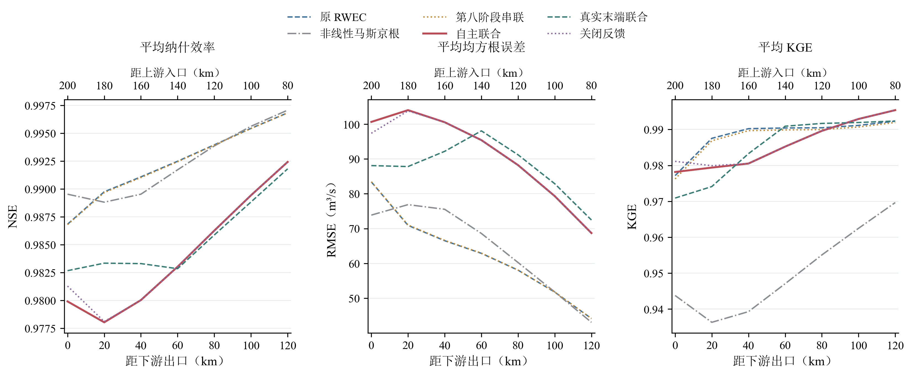
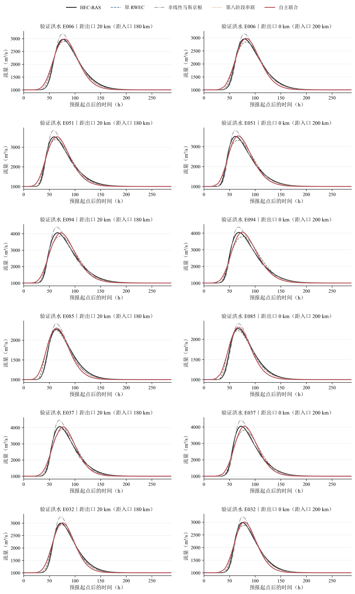
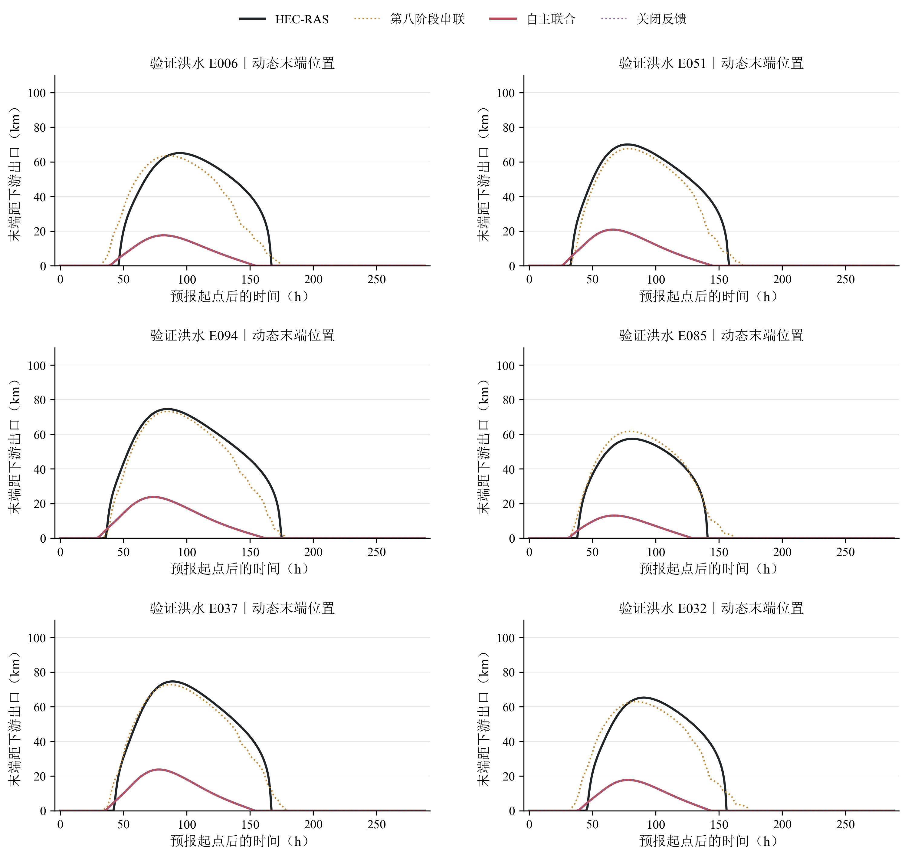
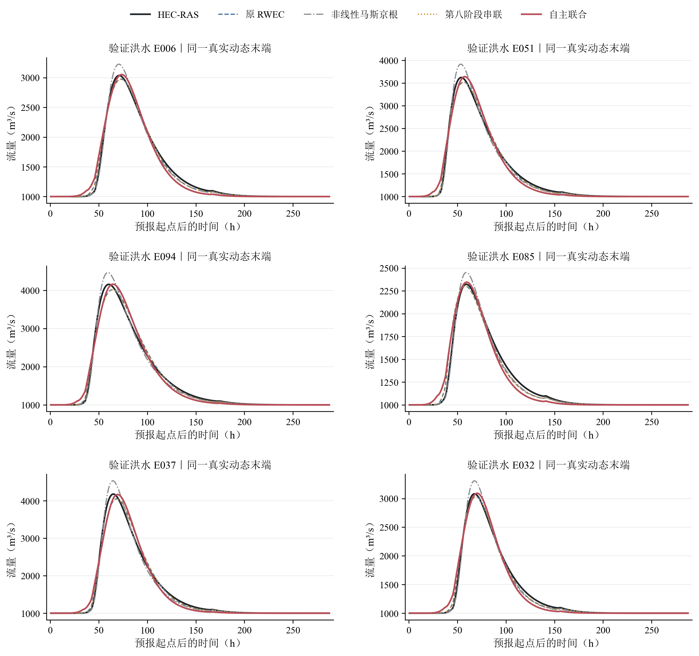
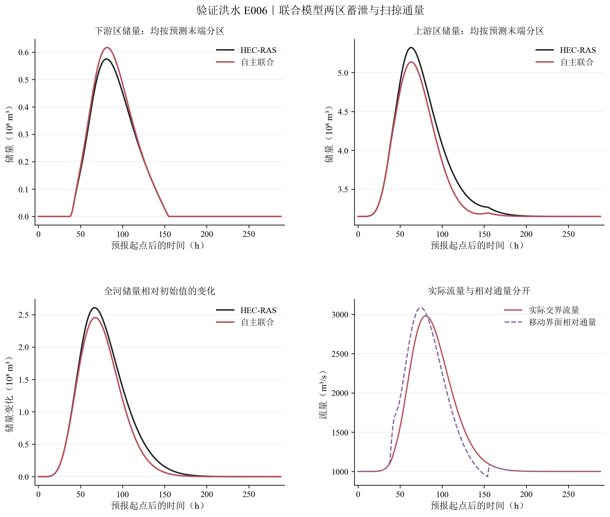
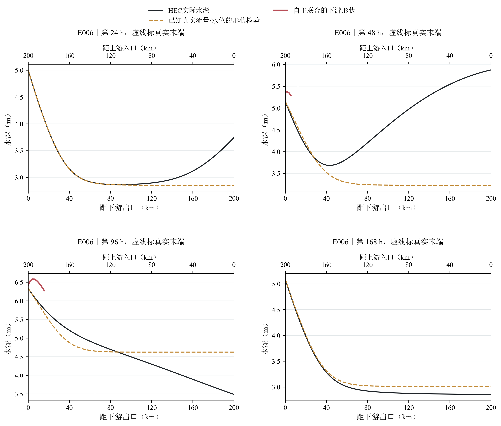
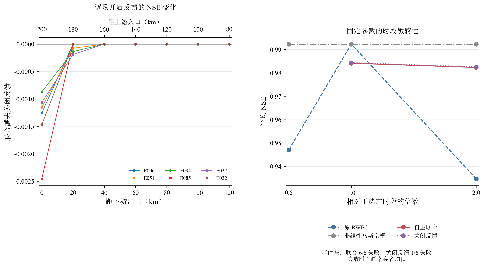
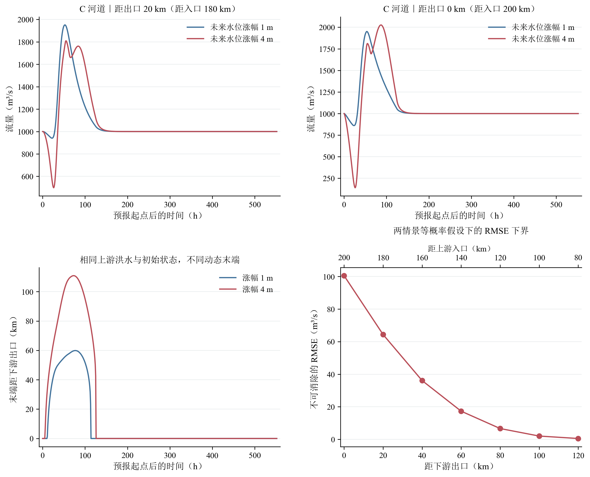

# 已知水力控制下的两区联合状态演进：第九阶段首轮开发验证

第九阶段已经将末端预测从外部八近邻预处理改为同一步内的两区联合求解。末端位置由内部水位形状确定，其变化进入上游 RWEC 活动长度、参考储量和重映射递推；上游出流通过下游储量平衡反过来改变出口水位和末端。现有 B 河道足以进行这项检验，因此本轮使用已有 HEC 配对结果，没有重建河槽。A、B、C 和第八阶段成果均保留，封存的30场测试未读取。

首轮结果不支持将这一候选作为优于原模型的新方法。自主联合模型在6场验证洪水、7个固定断面上的平均 NSE 为 0.984162，低于原 RWEC 的 0.992346 和非线性马斯京根的 0.992313。关闭边界反馈后，平均 NSE 为 0.984368；这组固定参数下开启反馈没有带来独立增益。与此同时，自主末端全过程平均绝对误差为 16.98 km，明显回水时段的误差为 40.60 km。流量精度接近0.98，不能掩盖末端机制没有得到正确恢复的事实。

## 数据、信息条件与比较口径

B 河道长200 km，底宽500 m，边坡3:1，坡度0.075‰，糙率0.025，初始流量1000 m³/s、出口水位5 m。下游是冻结的流量—水位控制关系，不是独立指定的未来水位。20场洪水沿用14场训练、6场验证，验证事件为 E006, E051, E094, E085, E037, E032。各场统一使用0—288 h；最短源数据也完整覆盖该窗口，窗口末各断面偏离1000 m³/s不超过 0.058 m³/s，已包含退水恢复。全部 HEC 流量保持正向，最小值约 999.997 m³/s。

预测断面距出口为120、100、80、60、40、20、0 km，对应距入口80、100、120、140、160、180、200 km。所有模型共同评价小时平均流量：HEC 与传统模型用线性时序积分，联合模型用其原生保守时段平均流量积分。这样避免直接把联合模型的时段平均通量与 HEC 瞬时流量混合比较。末端位置在整点评价；动态位置流量则在相同真实末端的小时中点位置插值，只将真实位置用于评分。

原 RWEC、第八阶段串联、线性与非线性马斯京根、真实末端联合和自主联合均搜索0.5、1 h两种时段，每种模型、每种时段最多320次目标函数调用，优化目标是14场训练洪水×7个断面的平均 NSE。非线性马斯京根单独调整指数、参考储量时间和入流权重；原 RWEC 调整原参数和时滞。全河采用同一组20 km子段参数，未给任何模型按验证断面增加专用参数。该预算是首轮有界搜索，不能视为全局最优证明。关闭反馈试验使用自主联合模型相同参数，不单独率定。

第八阶段串联在 B 训练洪水中重新建立八近邻库；训练事件留一，验证只查训练库。它仍属于外部末端预处理，未作为本轮主要创新。自主联合模型没有读取未来 HEC 水位、储量、出流或末端；其 HEC 输入仅为允许使用的起点水面。已知真实末端的理想试验单列，不称为自主预报。

## 物理闭合检验暴露的限制

候选用正常水深处渐变流线性化得到的长度尺度构造连续指数形状。未知量是本步交界实际流量与出口水位，回水边界由0.10 m水位抬升阈值确定。上游储量在末端推进和回撤时进行有符号体积重映射；随后执行原 RWEC 互补函数。完整定义、单位、两区平衡、参数重构与适用条件见 [可编辑方程](EQUATIONS.md)。这一实现是双向状态反馈，不再是“先预测长度、再把长度交给RWEC”。

在自主率定之前，先将真实末端、真实出口水位及真实末端流量提供给形状诊断，固定长度尺度倍数为1，不调整参数。验证集下游影响区的水位 RMSE 为 0.209 m，回水区储量 RMSE 相对其变化范围为 1.70%。然而，将这一储量变化、真实断面流量和扫掠体积独立代入连续方程后，残差 RMSE 达 52.74 m³/s；HEC自身按相同小时离散计算的残差为 0.58 m³/s。形状近似的误差明显超过时序离散本身。

真实末端联合试验仍允许内部水位与储量演进，但把末端固定为已知参考。其验证平均 NSE 为 0.985528，并未超过原 RWEC。更关键的是，该试验中指定末端处的形状水位差偏离0.10 m的 RMSE 为 0.387 m。说明“真实位置已知”和“当前形状能物理闭合”是两件不同的事，前者并没有修复后者。

末端误差中还存在参考状态定义的差异：HEC采用同一上游洪水、固定5m边界的非恒定配对参考；当前候选采用同一本步交界流量构造内部参照，尚未递推相应参考洪水的完整状态。两者不等价。因此上述阈值偏差不能全部归因于单一水面形状参数。后续需要让参考状态也保持因果演进，或明确建立两种影响边界之间的映射，不能偷用未来真实参考水面消除这项差异。

自主率定所得长度尺度倍数约为 0.297，真实末端联合试验约为 3.432。不同信息条件下差异如此大，结合末端过程图，说明流量目标可以通过缩短预测影响区等方式补偿形状偏差。当前候选没有同时解释末端、几何储量和蓄泄时序，不能把率定倍数作为已经识别的普适物理常数。

## 固定断面洪水与同位置末端流量

以下是全部6场验证、全部7个固定断面的逐场指标算术平均，共42个事件—断面组合，全部完成计算。洪峰和峰时列采用绝对误差平均，不抵消正负偏差。

| 模型               |   平均NSE |   平均RMSE（m³/s） |   平均KGE |   平均洪峰绝对误差（%） |   平均峰时绝对误差（h） |
|:-------------------|----------:|-------------------:|----------:|------------------------:|------------------------:|
| 原 RWEC            |  0.992346 |          62.531209 |  0.988468 |                2.776473 |                2.690476 |
| 非线性马斯京根     |  0.992313 |          64.287485 |  0.950523 |                6.637941 |                0.452381 |
| 线性马斯京根       |  0.979783 |         101.160961 |  0.940254 |                4.915647 |                3.285714 |
| 第八阶段串联       |  0.992309 |          62.577607 |  0.987892 |                2.844482 |                2.666667 |
| 真实末端联合       |  0.985528 |          87.528275 |  0.985029 |                1.666817 |                3.190476 |
| 自主联合           |  0.984162 |          90.978454 |  0.985891 |                0.564999 |                3.619048 |
| 关闭反馈（同参数） |  0.984368 |          90.482523 |  0.986390 |                0.549262 |                3.619048 |

距出口20 km和0 km的结果如下。它们分别对应180 km和200 km的累计演算，未剔除起涨、退水或恢复过程。

| model              |   x_from_outlet_km |   distance_from_inlet_km |      NSE |       RMSE |
|:-------------------|-------------------:|-------------------------:|---------:|-----------:|
| 关闭反馈（同参数） |                  0 |                      200 | 0.981287 |  97.382000 |
| 关闭反馈（同参数） |                 20 |                      180 | 0.978103 | 103.798733 |
| 自主联合           |                  0 |                      200 | 0.979910 | 100.637703 |
| 自主联合           |                 20 |                      180 | 0.978036 | 104.014545 |
| 真实末端联合       |                  0 |                      200 | 0.982671 |  88.088884 |
| 真实末端联合       |                 20 |                      180 | 0.983345 |  87.813596 |
| 线性马斯京根       |                  0 |                      200 | 0.970488 | 121.585199 |
| 线性马斯京根       |                 20 |                      180 | 0.970840 | 118.736848 |
| 非线性马斯京根     |                  0 |                      200 | 0.989535 |  73.873370 |
| 非线性马斯京根     |                 20 |                      180 | 0.988820 |  76.875919 |
| 原 RWEC            |                  0 |                      200 | 0.986841 |  83.413704 |
| 原 RWEC            |                 20 |                      180 | 0.989752 |  70.917856 |
| 第八阶段串联       |                  0 |                      200 | 0.986805 |  83.442775 |
| 第八阶段串联       |                 20 |                      180 | 0.989685 |  71.032519 |

所有模型在相同真实动态末端位置的流量指标如下。真实末端只用于定位评价点；不会反馈给自主联合、原RWEC、马斯京根或八近邻串联的演算。模型20 km网格上的流量做相同线性空间插值，HEC参考使用2 km网格。

| model              |      NSE |       RMSE |      KGE |
|:-------------------|---------:|-----------:|---------:|
| 原 RWEC            | 0.992675 |  57.647084 | 0.993307 |
| 非线性马斯京根     | 0.991496 |  64.925189 | 0.947322 |
| 线性马斯京根       | 0.976525 | 102.735507 | 0.932018 |
| 第八阶段串联       | 0.992638 |  57.676092 | 0.992747 |
| 真实末端联合       | 0.984518 |  86.404684 | 0.982714 |
| 自主联合           | 0.982836 |  88.889109 | 0.979797 |
| 关闭反馈（同参数） | 0.983260 |  87.948431 | 0.979769 |

逐场平均改善值保留原符号。下表每一行先对该场7个断面取平均，再计算联合模型相对各对照的变化；完整断面差值见 `tables/paired_NSE_changes.csv`。

| event   |   Joint_minus_RWEC0 |   Joint_minus_NLM |   Joint_minus_Serial8 |   Joint_minus_Feedback_off |
|:--------|--------------------:|------------------:|----------------------:|---------------------------:|
| E006    |           -0.007791 |         -0.005852 |             -0.007729 |                  -0.000179 |
| E032    |           -0.010223 |         -0.005670 |             -0.010158 |                  -0.000210 |
| E037    |           -0.007106 |         -0.008293 |             -0.007224 |                  -0.000179 |
| E051    |           -0.008710 |         -0.005386 |             -0.008698 |                  -0.000175 |
| E085    |           -0.011088 |         -0.016452 |             -0.010826 |                  -0.000351 |
| E094    |           -0.004189 |         -0.007258 |             -0.004251 |                  -0.000144 |

该结果只否定当前形状与状态映射组合的首轮效果，不足以否定所有联合状态模型。B的下游控制由已知固定关系闭合，入流与出流之间本就具有稳定的确定性联系；原RWEC在这里达到很高精度，应当如实保留。C中独立未来水位导致的预测困难不能直接移植成B的误差来源。

## 储量、扫掠项与数值稳定性

自主联合模型在自身预测末端分区下，与HEC在同一空间区间积分得到的储量相比，下游区储量 RMSE 为 1.86 百万m³，上游区为 10.17 百万m³；全河储量增量 RMSE 为 9.15 百万m³。下游区储量峰值相对真实末端分区的峰值时间平均偏差为 -3.50 h，此项含有边界位置不同的影响，不能单独归因于蓄泄速率。图5另外给出了同一预测位置分区的完整储量过程。

扫掠通量不属于普通断面流量。自主联合模型中其绝对值的时均量在验证事件间平均为 107.67 m³/s。输出分别保存实际交界流量、扫掠体积率和相对通量，图件没有用相对通量冒充真实流量。

所选时段下7种模型共140次完整事件演算均完成，没有负流量重建或负值裁剪。联合模型整步残差小于预设容限，常流保持和未来输入扰动的因果检查通过。这些检查只验证实现与信息边界。其几乎闭合的离散水量平衡不能替代前述真实水面、储量和断面流量检验。

本机单场288 h演算的记录中位耗时为：自主联合 0.008161 s、原RWEC 0.000374 s、非线性马斯京根 0.000957 s。该记录只包含数值演算，采用已缓存的编译代码，不含HEC计算、数据准备、率定和图表生成；它是本机首轮成本记录，不是跨机器性能保证。

固定参数的时间步长敏感性发现明显问题：自主联合模型改为0.5 h后6场验证均不收敛，关闭反馈在同一时段有1场失败；真实末端联合则全部完成。失败位置已保存在 `tables/failed_runs.csv`，没有用成功子集均值替代整体指标。原RWEC和串联模型虽然完成了计算，其精度也随时段显著变化；非线性马斯京根在此次检查中稳定。表中“全部6场平均NSE”为空即表示不能给出完整六场均值。

| 模型         |   时段倍数 |    时段h |   完成场数 |   总场数 |   全部6场平均NSE |   仅完成场次均值_非总体结果 |
|:-------------|-----------:|---------:|-----------:|---------:|-----------------:|----------------------------:|
| Feedback_off |   0.500000 | 0.500000 |          5 |        6 |       nan        |                    0.984237 |
| Feedback_off |   2.000000 | 2.000000 |          6 |        6 |         0.982559 |                    0.982559 |
| Joint        |   0.500000 | 0.500000 |          0 |        6 |       nan        |                  nan        |
| Joint        |   2.000000 | 2.000000 |          6 |        6 |         0.982379 |                    0.982379 |
| Joint_oracle |   0.500000 | 0.500000 |          6 |        6 |         0.985574 |                    0.985574 |
| Joint_oracle |   2.000000 | 2.000000 |          6 |        6 |         0.983790 |                    0.983790 |
| NLM          |   0.500000 | 0.250000 |          6 |        6 |         0.992319 |                    0.992319 |
| NLM          |   2.000000 | 1.000000 |          6 |        6 |         0.992290 |                    0.992290 |
| RWEC0        |   0.500000 | 0.500000 |          6 |        6 |         0.947078 |                    0.947078 |
| RWEC0        |   2.000000 | 2.000000 |          6 |        6 |         0.934657 |                    0.934657 |
| Serial8      |   0.500000 | 0.500000 |          6 |        6 |         0.946812 |                    0.946812 |
| Serial8      |   2.000000 | 2.000000 |          6 |        6 |         0.934710 |                    0.934710 |

这些失败表明，当前状态边界与重映射在更细时段下的联合求解尚不稳健。不能因为1 h下可以运行，就将其作为已完成数值验证的模型推广。没有通过不断更换洪水、放开验证调参或使用真实未来状态来修复这一结果。

## C 河道的信息不足及预测不确定性

C保留独立指定的未来水位，不强行套用B的固定控制关系。已有两场反事实HEC计算具有完全相同的上游流量、起点全河水位与起点前出口水位历史，相关差值逐项核对为零，但未来水位涨幅分别为1 m和4 m。由此产生不同的末端与出流。

在两情景等概率这一明确的思想实验假设下，0—552 h内任何仅用共同输入的确定性模型在出口的最小期望 RMSE 下界为100.53 m³/s，距出口20 km（距入口180 km）处为64.37 m³/s；末端位置的相应下界为 10.27 km。这是信息不足的定量证据，不是实际水位概率分布的估计。两情景包络也不宣称具有置信覆盖率。

另保留既有八近邻末端预处理的经验区间作为参考：C验证事件0—552 h全过程覆盖率均值94.15%，仅真实回水活动时段为85.76%，平均区间宽度23.07 km。长期平静尾段会抬高全过程覆盖率，且该10%—90%邻居分位区间未经概率校准，不能称为可靠80%预报区间。该外部预处理不作为联合模型创新，也未用于B率定。

## 研究判断与后续边界

当前结果提示，应先修正水面形状和储量状态的闭合，尤其是同一末端流量近似整段准恒定水面、以及单元内均匀面积重映射的限制。新的候选需要在真实末端已知条件下同时解释水面、两区储量和蓄泄时序，并在固定参数改变时段后维持稳定，随后再判断自主反馈是否有价值。仅增加邻居预测精度、放宽流量率定或继续提高NSE不能解决这些问题。

用户已允许必要时重建河道。当前B已有正流、移动末端和明确水力控制，失败证据首先指向模型闭合，尚无必须通过重建河槽补充数据的理由。若后续确有需要，应按缺失的水力激励和初始化条件预先定义新试验；不能以原模型精度过高或新模型精度不佳为依据选河道。C的未知独立未来边界仍需以条件情景或不确定性表述，不能靠内部联合求解消除缺失信息。

本轮为预先冻结样本的首轮开发验证。训练/验证参数、模型失败、物理闭合误差均保留；没有把结果提升为封存测试结论，也没有宣称双向耦合已经成功。

## 阅读与复核材料

- [完整可编辑方程与单位说明](EQUATIONS.md)
- [参数表](tables/parameter_table.csv)与[原始参数](PARAMETERS.json)
- [逐场固定断面指标](tables/fixed_section_event_metrics.csv)、[同位置动态末端指标](tables/dynamic_location_event_metrics.csv)
- [真实末端物理闭合检验](tables/known_endpoint_physical_closure.csv)、[两区状态指标](tables/joint_state_event_metrics.csv)
- [逐场改善值](tables/paired_NSE_changes.csv)、[失败记录](tables/failed_runs.csv)、[求解与成本](tables/solver_quality.csv)
- [因果性检查](provenance/causality_check.json)、[完整核验记录](provenance/verification.json)

### 图1 6场验证洪水在7个固定断面的逐场指标算术平均。上下横轴分别表示距出口与距入口距离。均值不替代逐场失败记录。

### 图2 全部6场验证洪水、距出口20km与0km的完整0—288h小时平均流量，无裁剪，无选择性省略。

### 图3 末端坐标从出口向上游量取；对应入口至末端演算长度为200减去纵轴值。真实末端联合使用真实位置，故不作为位置预测曲线重复绘制。

### 图4 所有模型在相同真实末端的小时中点位置插值评价。该位置只用于评价，不反馈自主预测；流量为实际断面流量，未加入扫掠相对通量。

### 图5 预先固定展示首场验证洪水E006。前两图在同一预测边界位置积分HEC储量，避免把不同空间区间直接作差；图中接近不证明末端位置正确。

### 图6 水位减河床高程得到水深。橙线使用真实Qb/H0作诊断，不是自主预报；红线仅在模型自身下游区绘制，未把未使用的形状延伸冒充上游RWEC状态。

### 图7 左图6场验证洪水逐场差值；右图仅在6场均完成时绘制均值，失败时留空并注明，未用幸存者均值代替总体结果。

### 图8 沿用已完成的同入流、同初始状态反事实HEC配对。两种未来边界均物理允许；等概率仅用于计算信息不足的理论下界，不代表已知实际概率。

