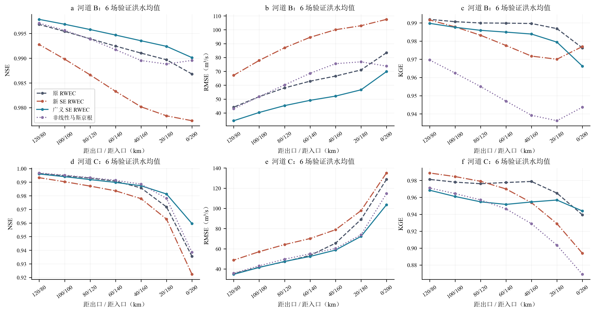
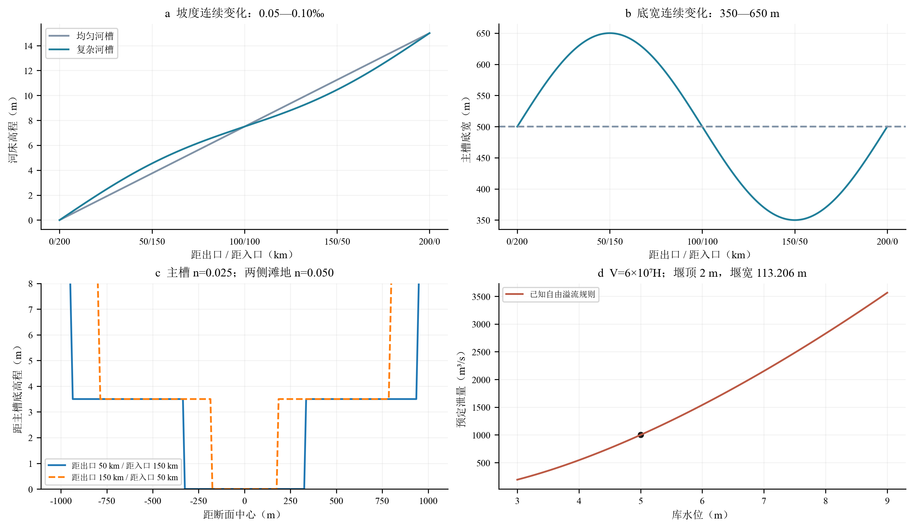
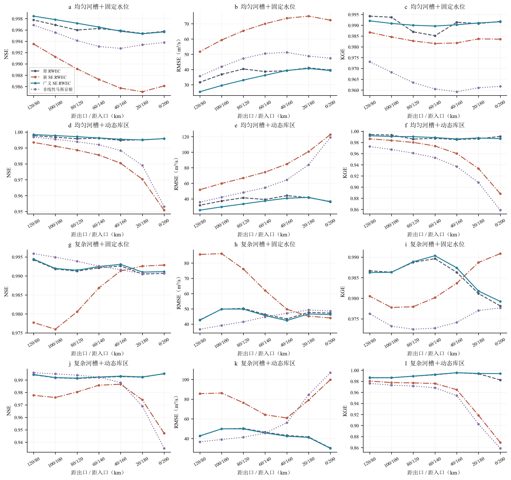
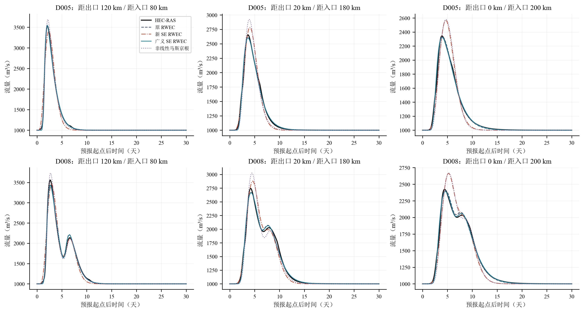
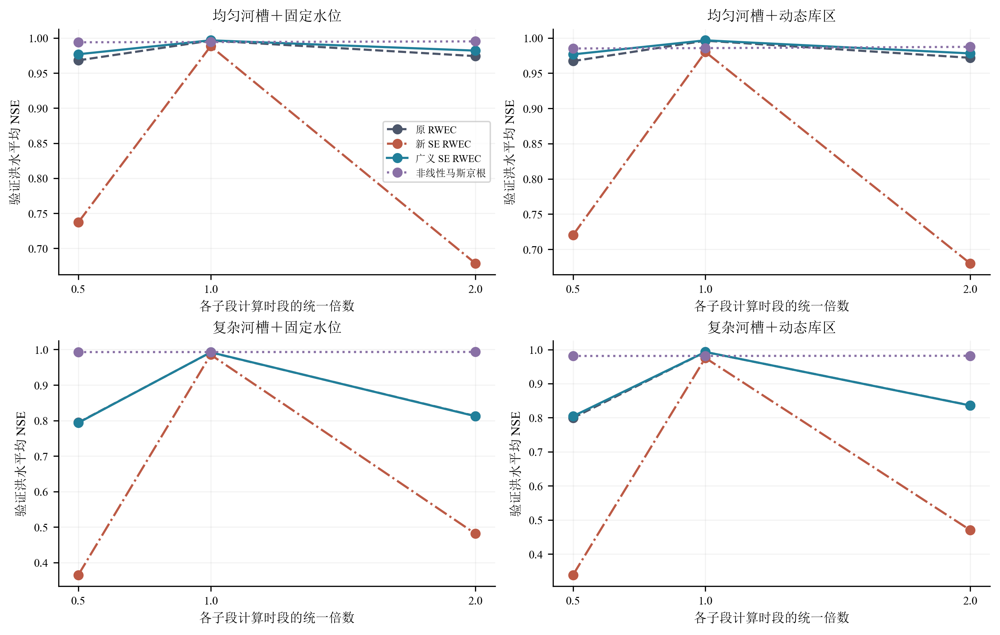
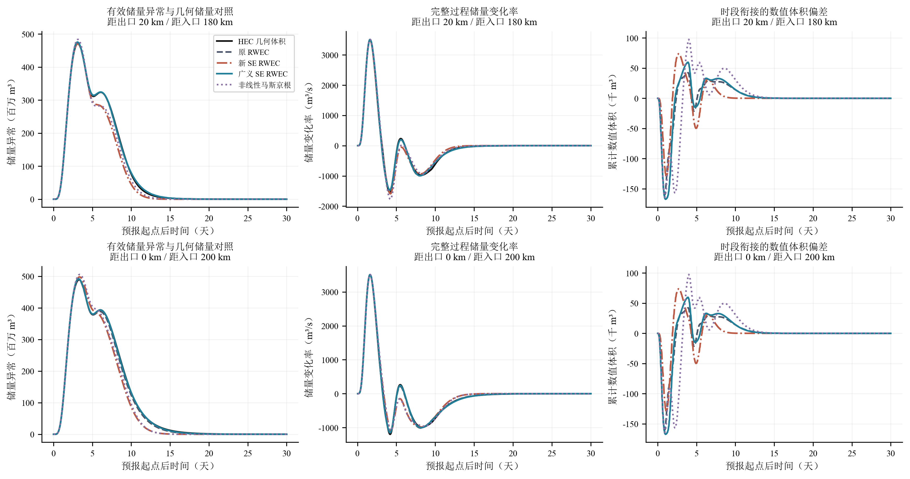
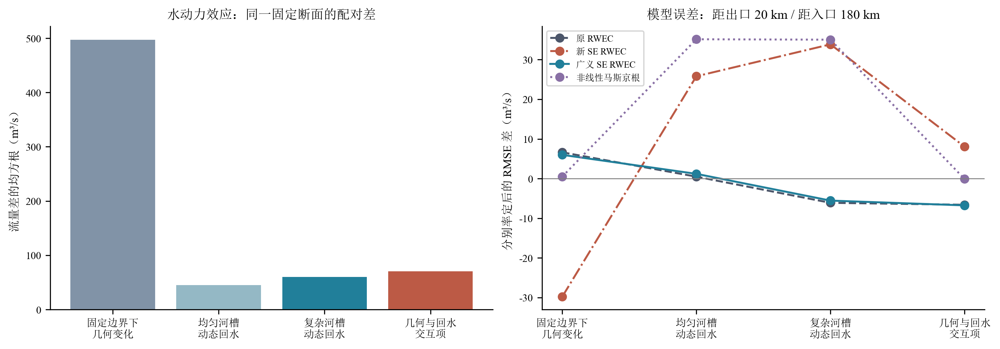
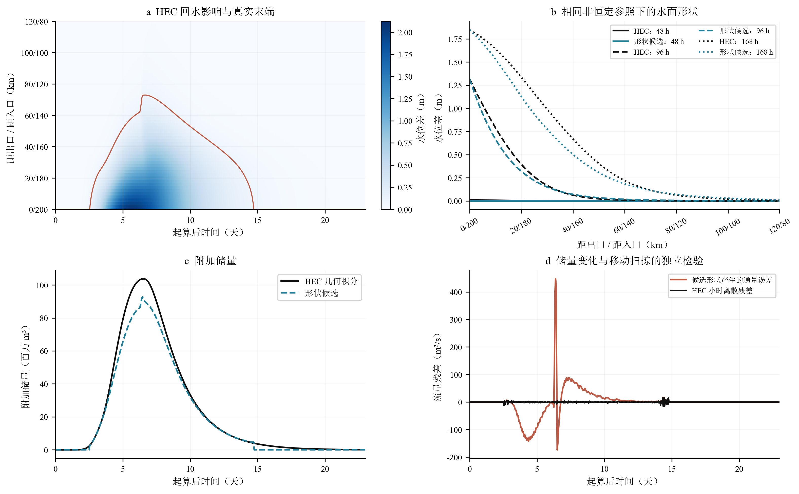

# 潜在滞蓄记忆结构与动态水库回水的独立检验

本阶段将“改变潜在滞蓄公式”和“引入动态回水耦合”作为两个需要分别证明的假设。原式、新式和广义式均重新推导恒定流状态、独立初始化并独立率定；河道 D 则采用由河道入流、库容曲线和固定泄流规则共同决定的库水位。已有河道 B、C 的控制比较表明，简单交换潜在滞蓄式中历史储量与入流体积的系数并未带来稳定优势。在新建复杂河槽与动态库区组合中，新式相对原式的七断面平均验证 NSE 差为 -0.01741，广义式为 +0.00018。完整逐场差值保留，均值不代表每场均改善。

河道 D 的 80 个正式水动力工况全部通过本轮数值质量与正流检查。连续水面形状的物理检验却未通过：两种不含率定参数的候选，在已经提供真实末端和同一洪水固定边界参照水面的条件下，仍不能同时解释水面、附加储量和移动控制体通量。因此，本轮没有形成“原式＋自主耦合”或“新式＋自主耦合”的有效验证结果。这个结论否定的是本轮两种简单几何闭合，不能推论所有联合状态模型都无效，也不能将较高的理想条件流量 NSE 称为自主预测增益。

三个 RWEC 家族共享 \(S_W=S_{t-1}+V_\tau\)、互补关系和水量守恒式；它们的区别严格限定为

\[
S_E=S_{t-1}+kV_\tau,\qquad
S_E=kS_{t-1}+V_\tau,\qquad
S_E=aS_{t-1}+bV_\tau.
\]

设恒定入流为 \(I_0\)，\(r=S^*/(I_0\Delta t)\)。每组参数独立求解

\[
\left(\frac r{r+1}\right)^n+\left(\frac r{ar+b}\right)^n=1.
\]

当 \(a,b,n>0\) 时存在唯一正稳态，且局地记忆因子介于零和一之间。\(n=1\) 时，原式的 \(r=\sqrt k\)，新式则为 \((k-1+\sqrt{(k-1)^2+4})/2\)。因而旧公式的数值 \(k\) 不能直接移植给新式。有效滞蓄状态也不能未经证明等同于几何河道体积。延迟采用独立在途储量记账，节点流量与逐小时区间平均的转换显式保留。推导、移动边界正负号、扫掠体积和单位检查见 [可编辑方程](EQUATIONS.md)；本地另存可编译的 `equations/main.tex`。

已有 B、C 各沿用 14 场训练和 6 场开发内验证，两个河道使用相同事件编号，不能算作 12 场新的独立洪水。三个 RWEC 家族及非线性马斯京根均可选择 0.25、0.5、1、2 h 计算时段，分别率定全部参数。训练阶段发现广义式初始搜索没有稳定覆盖嵌套原式后，在查看验证指标以前给所有模型、所有候选时段增加了相同预算；每个模型、每个河道共使用 8000 次目标函数调用。B、C 的参数按相同 20 km 子段重复使用，结果如下。这里及下文的综合均值先取每场、每个目标断面的指标，再等权平均，独立样本数仍是 6 场。

| 已有河道 | 模型 | 平均 NSE | 平均 RMSE（m³/s） | 平均 KGE |
|---|---|---|---|---|
| B | 非线性马斯京根 | 0.9923 | 64.2630 | 0.9505 |
| B | 广义 SE RWEC | 0.9945 | 49.7025 | 0.9825 |
| B | 新 SE RWEC | 0.9841 | 91.0048 | 0.9799 |
| B | 原 RWEC | 0.9923 | 62.5747 | 0.9879 |
| C | 非线性马斯京根 | 0.9831 | 61.7491 | 0.9343 |
| C | 广义 SE RWEC | 0.9857 | 58.6362 | 0.9559 |
| C | 新 SE RWEC | 0.9739 | 78.8245 | 0.9570 |
| C | 原 RWEC | 0.9811 | 65.8277 | 0.9709 |

这些结果不支持预先认定新式优于原式。广义式在部分指标上改善，但拥有额外自由度，而且已有 B、C 的若干参数达到搜索边界；有限预算的搜索也不等于全局最优。C 的下游水位原本为独立外部强迫，以上结果仅说明既有开发样本内的统计拟合能力，不能据此消除只知道上游来流时的边界不可辨识性。

河道 D 是具有工程构造依据的理想化试验河槽，并非实测河段或实际水库。均匀对照为 500 m 底宽、3∶1 边坡、糙率 0.025、坡度 0.075‰。复杂河槽的底宽在 350—650 m 连续变化，局地坡度在 0.05—0.10‰ 连续变化；主槽深 3.5 m，两侧各设置 600 m 滩地，主槽糙率 0.025、滩地糙率 0.050。两者端点高程、平均坡降及河长保持一致。断面分区输水能力的处理依据 [HEC 分区输水计算说明](https://www.hec.usace.army.mil/confluence/rasdocs/ras1dtechref/latest/stable-channel-design-functions/uniform-flow-computations/cross-section-subdivision-for-conveyance-calculations0?scroll-versions%3Aversion-name=6.7_beta4)，糙率作为可解释的理想化参数，参照 [HEC 能量损失与糙率资料](https://www.hec.usace.army.mil/confluence/rasdocs/ras1dtechref/6.4/basic-data-requirements/geometric-data/energy-loss-coefficients)。

动态边界采用原生 HEC 储水区，库容关系为 \(V_R=6.0\times10^7H_R\)（SI 单位）。泄流为固定自由溢流规则 \(Q_{\rm release}=1.7B_w[H_R-2]_+^{3/2}\)，堰宽由初始 5 m 水位下泄流 1000 m³/s 确定，按输入文件精度冻结。下游接收水体始终低于堰顶，仅维持自由溢流条件。河道出口连接储水区，HEC 内部共同求解入库流量、库容和库水位；输入文件没有未来库水位过程。原生连接依据 [HEC 储水区说明](https://www.hec.usace.army.mil/confluence/rasdocs/rasum/6.2/entering-and-editing-geometric-data/storage-areas) 与 [储水区水工连接说明](https://www.hec.usace.army.mil/confluence/rasdocs/rasum/6.4/entering-and-editing-geometric-data/storage-area-and-2d-flow-area-connections)。本轮使用 HEC-RAS 6.3.1，官方较新版算例仅用于核对原生输入结构，没有替换求解器。

先导比较了两种堰顶方案和四场单、复峰代表洪水，采用稳定基流预热及起点前 48 h 基流过程。原 552 h 窗口中两场复杂河槽试验未充分恢复，保留原结果并延长配对计算；正式试验统一使用 0—720 h 完整窗口。2 km 空间间距与 60 s 步长随后分别以 1 km、30 s 复核。最终选择只依据数值质量、全程正流、末端移动及抑流／恢复强度。早期先导提取记录中 v2 的资格标记不完整，完整重提取后 v2 也满足候选资格；按原定物理强度规则复核仍选择 v3，冻结几何、边界和样本均未改变。原始记录与复核结果同时保存在 `D_SELECTION_REPLAY.json`。

新的 20 场洪水在正式计算前固定随机种子和 14／6 划分，每场对应均匀／复杂河槽与固定 5 m／动态库区四种组合，共 80 次正式 HEC 计算。它们是 20 场洪水的因子配对，不能计作 80 场独立验证样本。主峰参数约 3000—6500 m³/s，部分洪水叠加预先生成的次峰；事件表中的主峰参数不等同于叠加后的实际总峰值。旧 30 场封存测试未读取。正式工况全河道计算步摘要的最小流量为 999.997 m³/s，HEC 最大绝对水量误差为 0.004988%，独立几何体积与端点通量积分的最大相对残差为 0.0529%，库容曲线独立核算的最大水量平衡 RMSE 为 0.684 m³/s。小时输出的最大弗劳德数为 0.2994。原生最大迭代次数字段全部为零，不能将其解释为实际迭代次数；质量判定同时依赖运行日志、全程正流、独立水量平衡和时空敏感性，未以“文件存在”替代检查。

正式洪水实际形成的水力范围如下。表中影响长度从出口向上游计量，范围是 20 场洪水各自最大值的最小值和最大值，并非精度范围带。80 次正式计算之外另保留 32 次成功的先导、恢复延长及数值敏感性计算，以及最早的输入失败工程。抑流指相对同断面固定边界的流量减少，不要求绝对流量降至基流以下。

| 河槽 | 各场最大涨幅最小值 m | 各场最大涨幅最大值 m | 最大影响长度最小值 km | 最大影响长度最大值 km | 最大附加储量最小值 百万m³ | 最大附加储量最大值 百万m³ |
|---|---|---|---|---|---|---|
| 复杂河槽 | 0.92 | 3.22 | 51.66 | 90.47 | 39.53 | 167.21 |
| 均匀河槽 | 1.28 | 3.87 | 67.28 | 106.46 | 22.04 | 70.03 |

四种组合的正式基准均允许每 20 km 子段独立率定参数与计算时段。采用从上游到下游的因果逐段搜索，下一段输入始终为模型自身的上段输出，训练观测仅作为目标。每个模型、每个子段、每个候选时段使用 2000 次目标函数调用，即每个模型、每种组合 80000 次；非线性马斯京根独立率定蓄量尺度、入流权重与非线性指数。目标为训练洪水平均 NSE，所有模型使用相同样本和完整评价窗口。该搜索保留了传统模型的率定自由度，但属于有限预算的逐段优化，不能证明已找到整个串联系统的全局最优。

正式比较前发现 HEC 浮点时间使名义起点 0 h 落在一个极小负值，漏掉起点后会使目标序列错开一小时。验证程序在第一场训练数据的长度检查时中止，尚未形成验证指标。全部受影响的 D 率定作废并归档，对经过核对的小时输出统一整数化，80 个工况均通过 721 个节点、720 个完整区间的对齐检查后，使用原预算重新率定。该修正未改变任何洪水、划分或优化边界；已有 B、C 比较不受影响。

| 条件 | 模型 | 平均 NSE | 平均 RMSE（m³/s） | 平均 KGE |
|---|---|---|---|---|
| 复杂河槽＋固定水位 | 非线性马斯京根 | 0.9929 | 43.8664 | 0.9748 |
| 复杂河槽＋固定水位 | 广义 SE RWEC | 0.9922 | 46.1886 | 0.9857 |
| 复杂河槽＋固定水位 | 新 SE RWEC | 0.9854 | 64.1596 | 0.9828 |
| 复杂河槽＋固定水位 | 原 RWEC | 0.9919 | 46.7939 | 0.9853 |
| 复杂河槽＋动态库区 | 非线性马斯京根 | 0.9813 | 58.5542 | 0.9435 |
| 复杂河槽＋动态库区 | 广义 SE RWEC | 0.9930 | 43.1022 | 0.9911 |
| 复杂河槽＋动态库区 | 新 SE RWEC | 0.9754 | 78.8673 | 0.9520 |
| 复杂河槽＋动态库区 | 原 RWEC | 0.9928 | 43.4870 | 0.9894 |
| 均匀河槽＋固定水位 | 非线性马斯京根 | 0.9942 | 46.1041 | 0.9639 |
| 均匀河槽＋固定水位 | 广义 SE RWEC | 0.9967 | 34.7960 | 0.9908 |
| 均匀河槽＋固定水位 | 新 SE RWEC | 0.9883 | 66.7824 | 0.9835 |
| 均匀河槽＋固定水位 | 原 RWEC | 0.9963 | 38.1989 | 0.9906 |
| 均匀河槽＋动态库区 | 非线性马斯京根 | 0.9855 | 63.9961 | 0.9368 |
| 均匀河槽＋动态库区 | 广义 SE RWEC | 0.9966 | 35.0060 | 0.9891 |
| 均匀河槽＋动态库区 | 新 SE RWEC | 0.9801 | 80.1857 | 0.9580 |
| 均匀河槽＋动态库区 | 原 RWEC | 0.9961 | 38.8852 | 0.9892 |

复杂河槽与动态库区中，长距离演算的两个关键断面结果如下。峰值误差与峰时误差保留正负号；均值可能发生抵消，完整表同时提供逐场值、均值、中位数、最小值和最大值。

| 距出口 km | 距入口 km | 模型 | 平均 NSE | 平均 RMSE | 平均 KGE | 平均峰值误差 % | 平均峰时误差 h |
|---|---|---|---|---|---|---|---|
| 0 | 200 | 非线性马斯京根 | 0.9351 | 106.8326 | 0.8588 | 8.7692 | -3.0000 |
| 0 | 200 | 广义 SE RWEC | 0.9950 | 30.0923 | 0.9939 | -0.3841 | 1.3333 |
| 0 | 200 | 新 SE RWEC | 0.9472 | 99.6926 | 0.8695 | 8.8005 | 3.3333 |
| 0 | 200 | 原 RWEC | 0.9952 | 30.3973 | 0.9824 | 0.3474 | 1.8333 |
| 20 | 180 | 非线性马斯京根 | 0.9689 | 84.3344 | 0.9024 | 9.7430 | 5.5000 |
| 20 | 180 | 广义 SE RWEC | 0.9925 | 41.1522 | 0.9942 | -1.9247 | -0.3333 |
| 20 | 180 | 新 SE RWEC | 0.9741 | 79.0806 | 0.9185 | 5.0853 | 8.1667 |
| 20 | 180 | 原 RWEC | 0.9923 | 41.6108 | 0.9937 | -1.7733 | 0.0000 |

预先希望得到约 0.70—0.85 的原 RWEC NSE 只是挑战性设想，不构成筛选条件。若本表仍显示较高精度，应承认本次复杂几何和可预报库区控制仍可被灵活率定的串联模型较好近似，不能为了降低原模型精度再次挑选验证工况。与已有 B、C 结果横向比较时，还必须注意 D 允许逐段独立参数，其自由度高于 B、C 的重复子段参数设置。

对每场验证洪水先平均七个断面的 NSE 差值，可得到下列改善计数。所有失败和负改善均保留，没有按模型表现删去洪水或裁剪流量。

| 条件 | 比较模型 | 改善场数 | 验证场数 | 平均差 | 中位差 | 最小差 | 最大差 |
|---|---|---|---|---|---|---|---|
| 均匀河槽＋固定水位 | 新 SE RWEC | 0 | 6 | -0.00798 | -0.00732 | -0.01268 | -0.00495 |
| 均匀河槽＋固定水位 | 广义 SE RWEC | 4 | 6 | 0.00040 | 0.00057 | -0.00018 | 0.00088 |
| 均匀河槽＋固定水位 | 非线性马斯京根 | 2 | 6 | -0.00206 | -0.00248 | -0.00634 | 0.00199 |
| 均匀河槽＋动态库区 | 新 SE RWEC | 0 | 6 | -0.01599 | -0.01525 | -0.02302 | -0.01081 |
| 均匀河槽＋动态库区 | 广义 SE RWEC | 5 | 6 | 0.00053 | 0.00060 | -0.00020 | 0.00105 |
| 均匀河槽＋动态库区 | 非线性马斯京根 | 0 | 6 | -0.01051 | -0.01153 | -0.01587 | -0.00419 |
| 复杂河槽＋固定水位 | 新 SE RWEC | 0 | 6 | -0.00649 | -0.00634 | -0.00996 | -0.00316 |
| 复杂河槽＋固定水位 | 广义 SE RWEC | 4 | 6 | 0.00033 | 0.00032 | -0.00032 | 0.00088 |
| 复杂河槽＋固定水位 | 非线性马斯京根 | 4 | 6 | 0.00098 | 0.00213 | -0.00428 | 0.00478 |
| 复杂河槽＋动态库区 | 新 SE RWEC | 0 | 6 | -0.01741 | -0.01662 | -0.02442 | -0.01165 |
| 复杂河槽＋动态库区 | 广义 SE RWEC | 4 | 6 | 0.00018 | 0.00023 | -0.00036 | 0.00073 |
| 复杂河槽＋动态库区 | 非线性马斯京根 | 0 | 6 | -0.01152 | -0.01005 | -0.02184 | -0.00612 |

固定参数下将各子段时段统一减半或加倍的结果见图 13 和 `D_time_step_mean_NSE.csv`。改变时段时重新建立该时段的恒定流初态，但不重新率定物理参数。RWEC 的局地记忆因子和有效储量尺度包含计算时段，因而率定时段取得高 NSE 不意味着跨时段不变性。最终参数的 160 次恒定流保持检查全部通过；完整基准预测失败子段数为 0，时段敏感性中无有效输出的目标行数为 0。这些失败计数与均值一起报告，避免以缺失值自动忽略失败。

另外重新记录了全部 320 次冻结预测的有效储量与子段衔接状态，流量与原预测逐点完全一致，没有增加率定。每个原生子段的水量方程成立，但不同子段时段之间的线性流量重采样并不自动保持相同体积；未经接口记账的整条河道最大累计偏差约占入流洪水增量体积的 0.1503%。本轮保留并单独报告累计重采样体积，加入这一明确的数值状态后总体记账闭合，但该状态不代表物理回水储量，也没有用于修正所报告的流量精度。不能将局部守恒或接口补记恒等式当作几何闭合的证据。广义式极小的精度改善还需放在这一数值衔接与时段敏感性背景下判断。

有效储量异常相对 HEC 几何储量的诊断如下。前者按各子段求解器储量异常和已知初始体积记录，包含既定节点／区间平均转换；它是待检验的等效体积，不因本表比较就获得真实几何水面解释。储量变化率与流量误差相关，也不能被当作独立于流量的第二份验证样本。

| 距出口 km | 距入口 km | 模型 | 储量异常归一 RMSE % | 储量变化率 RMSE m³/s |
|---|---|---|---|---|
| 0 | 200 | 非线性马斯京根 | 3.681 | 106.740 |
| 0 | 200 | 广义 SE RWEC | 0.514 | 30.095 |
| 0 | 200 | 新 SE RWEC | 3.948 | 99.837 |
| 0 | 200 | 原 RWEC | 0.825 | 30.375 |
| 20 | 180 | 非线性马斯京根 | 2.800 | 84.349 |
| 20 | 180 | 广义 SE RWEC | 0.739 | 41.144 |
| 20 | 180 | 新 SE RWEC | 3.531 | 79.164 |
| 20 | 180 | 原 RWEC | 0.742 | 41.579 |

几何与回水的作用在同一固定断面上计算。以 \(Q_{UF},Q_{UR},Q_{CF},Q_{CR}\) 表示四种 HEC 组合，则固定边界下的几何差为 \(Q_{CF}-Q_{UF}\)，均匀和复杂河槽的回水差分别为 \(Q_{UR}-Q_{UF}\) 与 \(Q_{CR}-Q_{CF}\)，交互项为 \(Q_{CR}-Q_{CF}-Q_{UR}+Q_{UF}\)。距出口 20 km、距入口 180 km 处，六场验证洪水中上述差值的平均 RMS 依次为 496.96、45.31、60.07 和 70.43 m³/s。这里的 RMS 是效应幅度，非线性运算后的数值不能相加分解总 RMS。对应模型误差亦作差分，但每种组合已分别率定，因此该误差差值描述适应后的表现，不能被解释为未经再率定的纯因果误差分解。

蓄入与释放阶段按 HEC 配对附加储量变化率大于 10 m³/s、小于 −10 m³/s 划分，其余为弱变化或恢复阶段。这一划分只服务于误差解释，不作为预测输入、事件筛选或率定窗口。完整阶段指标见 `D_storage_release_phase_errors.csv`。

动态末端以同一洪水的动态库区水面减去固定边界非恒定参照水面，并以 0.10 m 阈值确定。候选水面首先在真实末端、真实出口水位差及真实参照状态已知的理想条件下检验。分别采用指数距离和基于输水能力梯度的水力距离，两者均无经验率定系数。按照实际复式断面面积积分求储量，并对末端跨越区间积分求扫掠体积，再独立恢复实际末端断面流量；没有将相对移动界面的通量当作断面流量。

物理门槛在本轮候选计算前规定为：影响区水面 RMSE≤0.10 m、附加储量按真实变化范围归一的 RMSE≤5%、通量 RMSE≤max(10 m³/s，5 倍 HEC 小时离散残差)，以及末端流量 NSE≥0.95。两种形状在两种河槽、四场先导洪水上的 16 次检验全部未能同时通过。较好的水力距离候选在复杂河槽中的结果为：

| 先导洪水 | 水面 RMSE m | 附加储量误差 % | 通量 RMSE m³/s | HEC 离散残差 m³/s | 末端流量 NSE |
|---|---|---|---|---|---|
| DP01 | 0.1054 | 5.3414 | 49.6880 | 2.1436 | 0.9911 |
| DP02 | 0.1103 | 5.4138 | 53.5030 | 2.0637 | 0.9902 |
| DP03 | 0.0663 | 3.5071 | 29.1378 | 1.7629 | 0.9934 |
| DP04 | 0.1730 | 8.1877 | 51.7453 | 1.9459 | 0.9944 |

水面与总储量看起来接近，仍可能在储量导数中产生远大于 HEC 离散误差的通量残差。阈值末端跳动会使依赖端点整体伸缩的形状突然变化；即使只查看端点每小时位移不超过 2 km 的活动时段，通量误差也未消失。该分段结果仅作诊断，不用于替代完整评价窗口。形状尚未表示非恒定蓄入和释放的记忆，不能靠给守恒恒等式重新命名解决。所有基准模型在同一真实移动评价位置的流量结果另存 `D_same_endpoint_baseline_metrics.csv`；真实位置只用于统一评价位置，不作为基准模型的预测输入。

因此，第一个科学问题目前应回答为：严格换位的新潜在滞蓄式没有呈现跨河槽的一致优势；广义式是否具有实用价值，应结合本表的逐场改善、额外参数、边界命中和时段敏感性判断。第二个问题目前尚不能给出肯定答案：水面与储量闭合没有通过，尚无有效的自主联合模型可用于证明超出新公式本身的独立增益。后续若继续，应首先使固定边界参照状态和动态状态的水面形状具有可守恒的内部记忆，并重新通过同一物理门槛；不能用未来真实水位、真实储量或 8 近邻末端序列绕过此关口，也不应在本次验证集上反复增加经验系数。

全文对应的可复核入口为 [文件与复现说明](README.md)。逐场数据、全部参数、失败档案、时段敏感性和图件源代码均保留在本地第十阶段目录；HEC 原生工程与完整输出保留在独立河道 D 目录。前九阶段未改写，原 30 场封存测试未启用。本阅读包只包含轻量报告、公式、表格、程序及 PNG，完整 HDF 与时序留本地。
