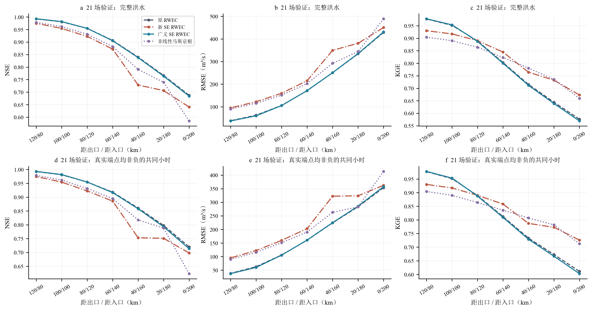
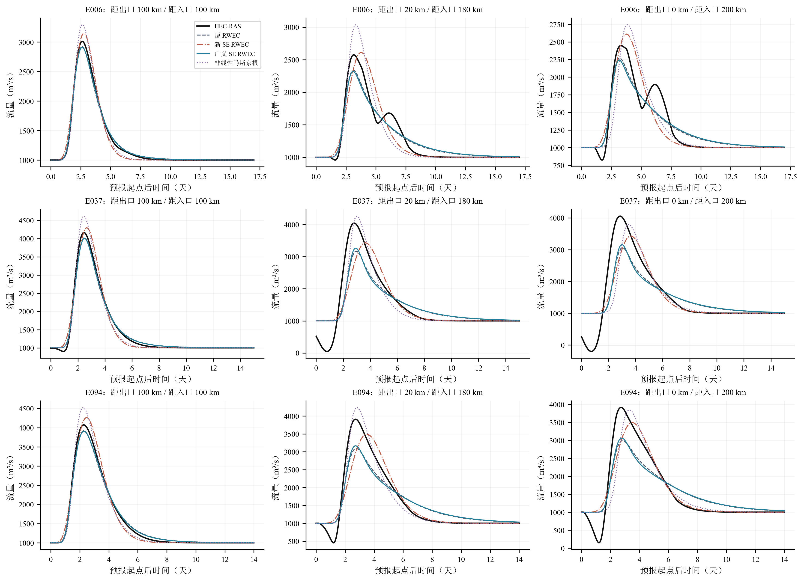
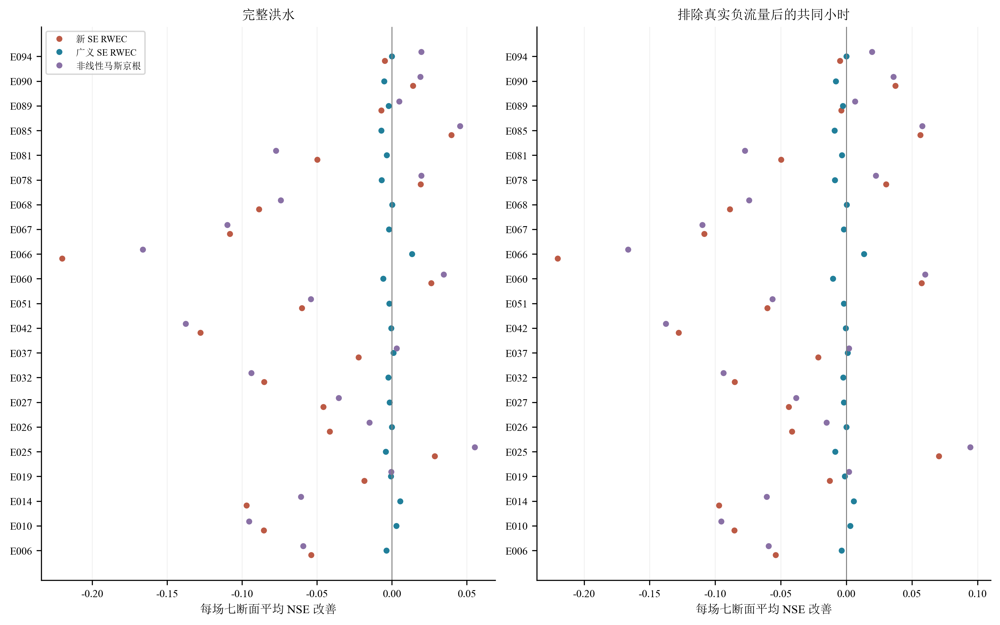
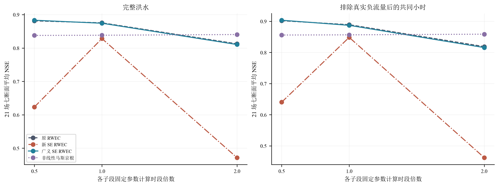
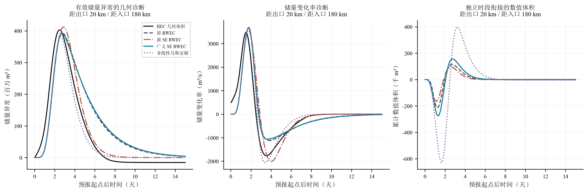
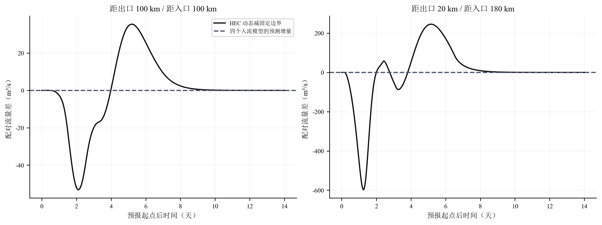

# 旧河道 A 的潜在滞蓄记忆结构再检验

本轮在最初的 200 km、0.05‰ 旧河道 A 上重新检验潜在滞蓄公式。原式、新式、广义式和非线性马斯京根均重新率定，使用原 49 场训练与 21 场开发内验证，全部预测不读取未来真实下游水位。排除真实负流量后的共同小时中，新式相对原式的七断面平均 NSE 变化为 -0.04070，广义式为 -0.00203；新式在 21 场中的 5 场取得七断面平均改善。均值、中位数及全部失败均保留，不能据某一场曲线决定公式优劣。

与前一轮 B、C、D 河道不同，A 的下游水位是独立外部强迫。模型只根据上游洪水和内部状态演进，因此本轮检验的是记忆结构对同一开发分布内的洪水演算是否有效，不能由高 NSE 推断模型已经自主恢复了未来独立水位过程。原 30 场封存测试未启用，原 HEC 工程未重跑。140 条主配对结果均通过既有初始化、原生水量平衡和恢复检查；32 场补充控制没有扩充本轮训练或验证样本。

严格比较的三个潜在滞蓄式为

\[
S_E=S_{t-1}+kV_\tau,\qquad S_E=kS_{t-1}+V_\tau,\qquad S_E=aS_{t-1}+bV_\tau.
\]

它们共享相同 \(S_W\)、互补关系和质量守恒求解。恒定入流下令 \(r=S^*/(I_0\Delta t)\)，各自独立求解

\[
\left(\frac r{r+1}\right)^n+\left(\frac r{ar+b}\right)^n=1.
\]

原式对应 \((a,b)=(1,k)\)，新式对应 \((k,1)\)。旧公式的数值 k 没有直接移植到新公式；原式的历史训练参数仅作为其搜索的一个起点。推导与局地记忆解释见 [可编辑方程](EQUATIONS.md)，TeX 文档已编译检查。

各模型都允许十个 20 km 子段分别率定参数及 0.25、0.5、1、2 h 时段。每模型、每段、每时段均为 2000 次目标函数调用，即每模型 80000 次，四个模型共 320000 次。为了保留原模型的既有自由度，任何本轮率定前就将正系数范围设为 10⁻⁴—e⁶，n 为 0.15—150、单段延迟 0—8 h；非线性马斯京根的蓄量尺度、入流权重与指数独立率定。下一子段始终使用模型自己的上段预测，不以未来真实内部流量替代。训练目标统一采用完整洪水过程，验证指标没有反过来决定参数范围或追加优化。

模型从 −48 h 恒定基流状态连续递推至各场原始完整终点，评分从 0 h 起。部分下游水位在洪水起点前已经上涨，它造成的真实抑流不能被解释为需要删除的数值启动扰动。按用户之前要求，同时计算两端 HEC 保存流量均非负的共同小时，以及最后一次负值后再缓冲 12 h 的连续窗口；三种窗口均在完整预测形成后评分，未在倒流处剪接或重置状态。后两种是真值条件下的事后诊断，不是可预先知道的业务预报条件，也不等于水力稳态。

全部模型和 HEC 都转换为相同的逐小时区间平均流量。与此前按保存节点评分、共享子段参数的历史数字相比，本轮的观察算子和参数结构有所区别，应以内轮同口径比较为准。完整与排负后平均结果如下，独立单位为 21 场事件，七个断面不扩充独立洪水数。

| 窗口 | 模型 | 平均 NSE | 平均 RMSE m³/s | 平均 KGE |
|---|---|---|---|---|
| 完整洪水 | 非线性马斯京根 | 0.8383 | 240.7433 | 0.8082 |
| 完整洪水 | 广义 SE RWEC | 0.8743 | 198.8901 | 0.7912 |
| 完整洪水 | 新 SE RWEC | 0.8283 | 253.3888 | 0.8217 |
| 完整洪水 | 原 RWEC | 0.8754 | 198.8552 | 0.7937 |
| 排除真实负值共同小时 | 非线性马斯京根 | 0.8566 | 215.3337 | 0.8279 |
| 排除真实负值共同小时 | 广义 SE RWEC | 0.8871 | 176.0181 | 0.8038 |
| 排除真实负值共同小时 | 新 SE RWEC | 0.8485 | 227.0273 | 0.8403 |
| 排除真实负值共同小时 | 原 RWEC | 0.8892 | 175.6162 | 0.8067 |

距出口 100 km（距入口 100 km）处，21 场验证均没有负流量，最小保存流量为 544.75 m³/s，因而完整和排负窗口相同。距出口 20 km（距入口 180 km）处有 8 场出现负值，另有 13 场完整洪水保持非负；这部分完整正流事件另列结果，但没有替换原 21 场验证集合。关键断面的结果为：

| 距出口 km | 距入口 km | 模型 | 完整 NSE | 排负 NSE | 排负 RMSE | 排负 KGE | 排负峰值误差 % | 排负峰时误差 h |
|---|---|---|---|---|---|---|---|---|
| 0 | 200 | 非线性马斯京根 | 0.5849 | 0.6235 | 413.4594 | 0.7127 | -3.8660 | 12.4286 |
| 0 | 200 | 广义 SE RWEC | 0.6840 | 0.7137 | 357.4223 | 0.6028 | -17.0650 | -3.9524 |
| 0 | 200 | 新 SE RWEC | 0.6407 | 0.6982 | 362.4025 | 0.7260 | -9.8025 | 11.1429 |
| 0 | 200 | 原 RWEC | 0.6875 | 0.7202 | 353.8032 | 0.6110 | -17.9720 | -3.2381 |
| 20 | 180 | 非线性马斯京根 | 0.7393 | 0.7881 | 282.8800 | 0.7818 | 8.2441 | 1.9048 |
| 20 | 180 | 广义 SE RWEC | 0.7639 | 0.7929 | 285.6985 | 0.6665 | -14.0694 | -3.5714 |
| 20 | 180 | 新 SE RWEC | 0.7063 | 0.7510 | 323.8299 | 0.7728 | -9.6272 | 13.1429 |
| 20 | 180 | 原 RWEC | 0.7666 | 0.7976 | 283.6352 | 0.6728 | -15.1209 | -2.8095 |
| 100 | 100 | 非线性马斯京根 | 0.9618 | 0.9618 | 115.7007 | 0.8902 | 11.3686 | 0.6667 |
| 100 | 100 | 广义 SE RWEC | 0.9817 | 0.9817 | 60.2439 | 0.9534 | -0.9003 | -0.0952 |
| 100 | 100 | 新 SE RWEC | 0.9542 | 0.9542 | 122.4430 | 0.9172 | 4.7493 | 4.1429 |
| 100 | 100 | 原 RWEC | 0.9808 | 0.9808 | 62.8961 | 0.9514 | -0.3958 | -0.0952 |

为与此前记录衔接，另外对第五阶段已经冻结的共享参数原 RWEC 按本轮小时均值和共同掩码重新评分，没有再训练或据此替换本轮模型。该历史参照在 100 km、20 km 处的排负 NSE 分别为 0.98099、0.84068。它原来在固定／变水位多场景上率定，当前四模型则使用主变水位、逐段局部率定，两者训练目标不同。更高的历史参照也说明，本轮扩大参数数量和逐段搜索并不保证整个级联目标已达到全局最优；不能将不同率定方案的差值归因于公式。历史冻结预测完整单列在 `historical_frozen_original_event_metrics.csv`。

本次四个新率定模型在这些洪水上的预测最小值均为约 1000.0 m³/s，而 20 km 的完整正流事件中，真实流量也会明显降至基流以下。因而误差并不只发生在负流量阶段：在不倒流的区间，独立下游水位造成的抑流仍未由仅有上游输入的这四个模型还原。交换潜在滞蓄式的系数没有提供缺失的外部边界信息。

本图在形成验证结果前指定 E006、E037、E094，另图指定 E010、E051、E068；这些事件在 20 km 处属于全程正流背景，出口处仍可能出现负值，真值曲线完整保留。其余每一场验证洪水也各有 `event_场次_full_hydrographs.png`，同时展示 100 km、20 km 和出口。不能只看峰值接近而略去前期抑流和退水额外释放。

下表对每场先平均七个断面的 NSE 改善，再统计全部 21 场，保留最差场次和负改善。

| 窗口 | 比较模型 | 场数 | 改善场数 | 平均改善 | 改善中位数 | 最小改善 | 最大改善 |
|---|---|---|---|---|---|---|---|
| 完整洪水 | 新 SE RWEC | 21 | 5 | -0.04712 | -0.04573 | -0.22019 | 0.03957 |
| 完整洪水 | 广义 SE RWEC | 21 | 5 | -0.00118 | -0.00180 | -0.00708 | 0.01331 |
| 完整洪水 | 非线性马斯京根 | 21 | 8 | -0.03712 | -0.03562 | -0.16637 | 0.05516 |
| 排除真实负值共同小时 | 新 SE RWEC | 21 | 5 | -0.04070 | -0.04410 | -0.22019 | 0.07037 |
| 排除真实负值共同小时 | 广义 SE RWEC | 21 | 5 | -0.00203 | -0.00193 | -0.01022 | 0.01331 |
| 排除真实负值共同小时 | 非线性马斯京根 | 21 | 9 | -0.03261 | -0.03843 | -0.16637 | 0.09425 |

广义式具有额外自由度，四种模型仍属于有限预算、逐段优化，而非全局最优证明。参数表列明全部边界命中；各模型边界参数累计数为 {'NLM': 17, 'general': 8, 'new': 14, 'original': 0}。固定参数将各子段时段统一减半或加倍的敏感性另列，不能在最有利的离散时段取得较高精度后就认定参数已具有稳定物理意义。最终 40 组子段参数的恒定流保持检查结果为 True，预测失败子段数为 0。所有时段敏感性仍完整保留，没有据其验证精度重新率定。

有效滞蓄状态不自动等于几何河道蓄量。本轮同时记录储量异常、储量变化率和数值接口体积；独立时段之间的流量重采样导致的最大累计体积偏差占入流洪水增量体积约 0.1683%。这项体积单独记账，不充当回水储量，也不用于修改已报告的流量预测。局部守恒及接口补记恒等式均不能单独证明水面闭合成立。

对同一洪水，固定与变动边界具有相同上游输入。本轮四个模型没有外部边界状态输入，因而给出同一条配对预测，其预测边界增量恒为零；真实配对出流差则保留在同一固定空间断面比较。固定 5 m 表中的结果明确标记为“相同预测的参照评分”，并非在固定边界上另外优化后的成绩。主体洪水拟合即使较好，也不能由此说明额外边界响应已被预测。

本轮结论应同时依据完整过程、排负共同窗口、逐场胜负和时段敏感性。若新式只改变平均传播或使个别事件更接近，尚不足以证明其比原式普遍更适合回水河道。由于这些开发内验证事件已用于此前研究，本次只能作为新公式的进一步开发证据，不能冒充封存测试或独立跨场景成功。全部代码、参数、逐场指标与完整预测见 [文件与复现入口](README.md)，前十阶段成果保持原样。
